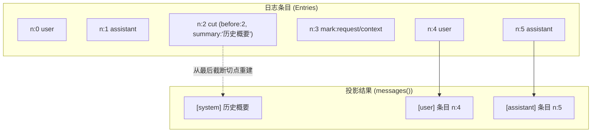
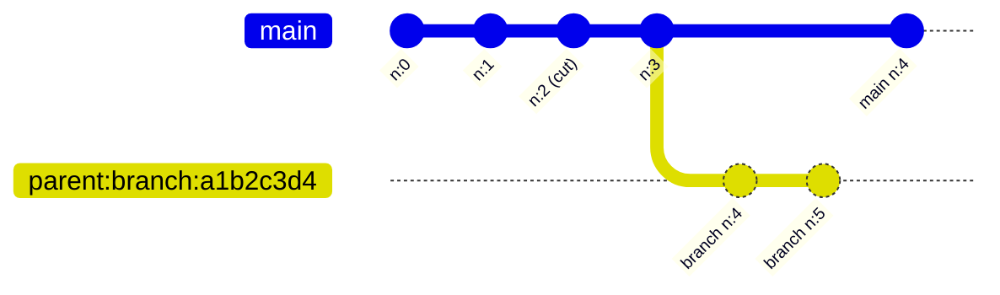

# 会话、消息与分支

在 ChatLuna 架构中，`ctx.sessions` 负责底层的会话生命周期与历史管理。与其他常见聊天框架不同，ChatLuna 中的会话并不是一个可以随意修改的消息列表，而是一份严格的**只追加日志（Append-only Log）**。

最终发给大语言模型的上下文，也并非直接存储的静态数据，而是由这条有序日志在运行时动态计算得出的**投影（Projection）**。用户的输入、模型的回复、预设的切换、上下文压缩截断，以及运行时的各类元数据事件，都会作为不可变（Immutable）的条目依次追加到日志中。会话日志本身即是整个系统状态的**唯一事实源（Single Source of Truth）**。

## 会话与头部

每个会话都由全局唯一的 `SessionId` 标识，并在存储层持有一份轻量的头部元数据 `SessionHeader`。

### SessionHeader 字段定义

| 字段 | 类型 | 说明 |
| :--- | :--- | :--- |
| `sessionId` | `string` | 会话全局唯一标识符 |
| `formatVersion` | `number` | 格式版本号，常量 `CURRENT_SESSION_FORMAT = 1` |
| `createdAt` | `number` | 创建时间的时间戳（毫秒） |
| `parent` | `string?` | 分支来源的父会话 ID（仅分支会话存在） |
| `at` | `number?` | 分支切出时在父会话中的条目序号（仅分支会话存在） |
| `delegationDepth` | `number` | 委派深度，主会话为 `0`；分支默认复制父会话的值，除非创建时显式指定 |
| `title` | `string?` | 会话的可选展示标题 |
| `origin` | `JsonValue?` | 任意 JSON 来源元数据（例如平台、路由或子代理来源） |

从现有会话派生新分支时，新会话的头部会通过 `parent` 与 `at` 精确记录父会话及其切出点。`delegationDepth` 不会自动递增：子代理在创建时由调用方显式传入深度，普通分支则直接沿用父会话的值。

## 条目模型

会话日志由按序号连续排列的条目（Entry）构成。无论具体属于哪种类型，每个条目都具备两个基础的不变量字段：
- `n`：从 `0` 开始单调递增且严格连续的整数序号（`0, 1, 2, ...`）。
- `time`：条目记录时的毫秒时间戳。

根据 `kind` 判别联合，系统中的条目分为三类：
1. `message`：承载对话消息体（`ChatMessage`）。
2. `mark`：承载管线标记、上下文元数据与调度控制记录。
3. `cut`：承载上下文截断与历史摘要切点。


### 消息元数据（Message Meta）

在 `message` 条目中，消息体附带了细粒度的执行元数据 `meta`，便于统计与审计：
- `turn`：所属对话轮次计数。
- `step`：当前轮次内的执行步骤（例如工具调用的多步循环）。
- `usage`：该条消息消耗的 Token 统计（`inputTokens`、`outputTokens`、`totalTokens`）。
- `finish`：模型结束生成的停机原因（例如 `stop`、`tool_calls`、`length`）。
- `timing`：请求与响应各阶段的耗时分析（首字延迟、解码耗时等）。

## 标记（mark）

标记条目（`kind: 'mark'`）用于在不污染模型上下文历史的前提下，记录管线生命周期中的上下文变更、调度决策与输入审计。**所有 mark 条目均不会作为消息直接发送给模型**。

| Mark 名称 | Data 载荷结构 | 作用说明 |
| :--- | :--- | :--- |
| `prompt` | `PromptSnapshot`（包含 `ChatEpochHeader` 与 `turn/step/reason/sources`） | 记录当前生成的 Prompt 快照与派生上下文 |
| `preset/selected` | `{ presetId: string, revision: string }` | 记录会话绑定或切换预设的版本 |
| `request/context` | `{ provider: string, model: string, contextWindow?: number }` | 记录推理请求的目标供应商、模型与窗口大小 |
| `agent/input-enqueued` | `{ messageId: string, message: any, target: 'next-turn' \| 'next-step', wakeup: boolean, enqueuedAt: number }` | 记录 Agent 输入排队入队事件 |
| `agent/input-admitted` | `{ messageId: string, n: number }` | 记录排队的输入被调度引擎正式采纳写入日志 |
| `agent/input-discarded` | `{ messageId: string, reason: string }` | 记录过时、冲突或被丢弃的输入消息 |
| `turn-skip` | `{ reason: string, detail?: string, turn?: number }` | 跳过当前轮次，自带 `turn` 以标记位置 |

在 `prompt` 快照中，系统会根据 `provider`、`model`、`reasoningEffort`、`temperature`、`maxTokens`、`stop`、`system`、`prelude` 和 `tools` 等参数计算规范化 JSON 哈希 `promptDigest`，用于精准判定 Epoch 边界与上下文缓存的有效性。

## 追加写入与并发

会话日志具备强一致性的追加语义与严格的不变量约束。

### 写入机制与乐观锁

为了应对可能的并发写入，系统采用内存队列与底层乐观锁相结合的机制：

1. **计算 expectedN**：写入前根据当前内存条目数确定下一个期望序号 `expectedN`。
2. **底层存储校验**：通过 `store.put(sessionId, expectedN, entries)` 批量持久化。若底层条目已发生变动，存储层会拒绝写入并抛出异常：
   ```ts
   throw new SessionConflictError(sessionId, expectedN, actualN)
   ```
3. **内存串行队列**：在单个会话实例内部，所有写操作（`write`、`commit`、`mark`、`compact`）都会自动进入串行 Promise 队列，防止进程内并发乱序。
4. **提交约束**：`commit` 方法仅允许提交 `assistant` 消息，成功追加写入日志后会立即清理内部草稿（draft）。
5. **不变量检查（checkInvariants）**：该诊断方法供 doctor 或导出工具显式调用，不会在每次写入时执行。它主要检查以下内容：
   - 序号 `n` 必须从 `0` 开始严格连续单调递增，无空缺、无重复；
   - `cut.before` 必须为非负整数，且取值落在当前有效区间 `[0, n]` 内；
   - 条目载荷必须能通过 JSON 安全序列化。

## 投影

上下文投影是指将底层的事件日志折叠并转换为大语言模型可理解的消息视图。



### 投影计算规则

投影计算遵循以下规则：

- **`messages()` 投影**：从日志中检索最后一个 `cut` 条目。若存在 `cut`，则以 `cut.summary` 中的消息作为历史起点，随后拼接该 `cut` 之后出现的全部 `message` 条目；若不存在 `cut`，则直接返回日志中的全部 `message` 条目。
- **投影缓存**：会话实例在内存中维护 `cachedAt` 标记。当且仅当 `cachedAt !== entryList.length` 时触发重新计算；遇到 `cut` 操作时会强制使全量投影失效并重新计算。
- **软截断语义**：`cut` 属于软截断（Soft Truncation）。早于 `cut.before` 的原始条目仍完整保留在只追加日志中，审计和回溯时不会丢失任何信息。
- **请求重建**：调用 `reconstructRequest(atN)` 可根据指定序号 `atN` 处的 `prompt` 标记与上下文快照，完整复原当时发送给大模型的实际请求载荷。

## 分支

分支机制允许你在任意历史位置切出一条独立演进的新分支，常用于探索不同的生成策略或调试子代理。



### 分支实现机制

- **API**：调用 `branch(at, options)`。其中切出序号 `at` 必须满足 `0 <= at <= entryList.length`。
- **数据复制**：子会话直接复制父会话中 `0..at` 的完整条目镜像，确保历史完全一致。
- **头部属性**：
  - `parent`：设置为父会话的 `sessionId`；
  - `at`：记录分叉时的切出序号；
  - `delegationDepth`：默认复制父会话的值；需要更深层级时可由调用方显式指定。
- **命名规范**：若未显式指定新会话 ID，默认生成形如 `<parent>:branch:<8位hex>` 的格式（截取 UUID 前 8 位十六进制字符）。
- **事件广播**：分支创建成功后，将触发 `chatluna/session-branch` 事件，事件载荷为 `{ parent, session, at }`。

## 压缩切点

当会话长度超出模型上下文窗口或需要精简长篇记忆时，压缩器会调用 `compact` 插入 `cut` 条目。

### 切点条目结构

```ts
interface CutEntryData {
  before: number          // 截断生效点，处于 [0, n]
  summary: ChatMessage[]  // 折叠旧历史得到的消息序列（通常是摘要消息）
  reason: string          // 触发压缩的原因（如 token_limit, manual）
  native?: unknown        // Provider 专属的原生压缩块（可能包含 unusable 状态）
  meta?: Record<string, unknown> // 额外诊断元数据
}
```

- **生效机制**：`compact` 同样作为一条普通的日志条目通过 `write` 写入。
- **Provider 原生压缩支持**：`native` 字段可保存模型服务商原生生成的压缩缓存块。若该缓存失效或标记为 `unusable`，投影逻辑会自动降级使用 `summary`。
- **投影重定向**：写入 `cut` 之后，后续调用 `messages()` 时都将忽略此前的离散条目，直接以 `summary` 中的消息作为起点向后重组。

## 存储契约

会话的持久化与加载通过抽象接口 `SessionStore` 完成，与具体存储介质解耦。

### SessionStore 接口契约

```ts
interface SessionStore {
  head(id: SessionId): Promise<SessionHead | undefined>
  read(id: SessionId, from?: number): Promise<readonly SessionEntry[]>
  put(id: SessionId, expectedN: number, entries: readonly SessionEntry[]): Promise<void>
  create(header: SessionHeader, entries?: readonly SessionEntry[]): Promise<void>
  list?(options?: { parent?: SessionId; limit?: number }): Promise<readonly SessionHeader[]>
  delete?(id: SessionId): Promise<boolean>
}
```

### 实现与临时会话

- **默认存储**：ChatLuna 内置提供了 `MemorySessionStore`，适用于测试与无状态运行环境。
- **持久化扩展**：生产环境下，推荐加载 `@chatluna/session-persistence-sqlite` 插件。该插件会在上下文中注册 `session_store` 服务，提供持久化的 SQLite 存储后端。
- **临时释放机制（releaseIfEphemeral）**：当检测到上下文中未注册 `session_store` 服务实现（即仅使用内存存储）时，系统会在适当时机调用 `releaseIfEphemeral` 清理并释放临时会话占用的内存，防止长期驻留导致内存泄漏。

## 服务 API

`ctx.sessions` 对外暴露的主要管理方法如下：

- **`open(sessionId)`**：若 `store.head` 存在，则读取其全部条目并返回会话实例；若不存在，则隐式调用 `create` 创建新会话。需要注意：**每次 `open` 返回的都是独立的会话快照实例**，进程内或进程间的并发写入冲突会在调用 `store.put` 时暴露并处理。
- **`create(id?, options)`**：创建新会话。传入 `parent` 与 `at` 时，会将父会话切点之前的条目复制过来；`delegationDepth`、`origin` 和 `title` 可显式指定，未指定时沿用父会话的配置。
- **`branch(sessionId, at, options)`**：在指定序号处分叉并返回新会话实例。
- **`list()`**：列出当前存储中的所有会话头部信息。
- **`head(sessionId)`**：读取会话头部元数据，不加载条目日志。
- **`delete(sessionId)`**：销毁会话及其关联的所有条目日志。
- **`define(markName, schema)`**：向系统注册自定义 mark 类型的校验 Schema。

### 错误类型系统

系统定义了结构化的错误类，便于精确捕获并处理异常：
- `SessionConflictError`：并发追加写入导致序号不匹配（包含 `sessionId`、`expectedN`、`actualN`）。
- `SessionNotFoundError`：操作不存在的会话 ID。
- `SessionAlreadyExistsError`：创建已存在的会话。
- `SessionError`：基础会话异常基类。

## 与其它子系统的关系

会话日志子系统处于 ChatLuna 上下文管道的核心，与其他模块保持松耦合协作：

- **会话聚合（`conversations`）**：`ctx.conversations` 负责维护顶层逻辑会话标识（`key` 到 `head` 的映射路由），管理最终用户或聊天群组当前指向的具体 `SessionId`。
- **智能体引擎（`agents`）**：`agents` 负责打开目标会话、组装执行环境，并在循环交互中向日志写入 `message` 和 `agent/*` 标记。
- **压缩子系统（Compaction）**：在后台监控上下文窗口与消耗，计算历史摘要并向会话写入 `cut` 条目。
- **链路追踪（Trace）**：通过会话条目中的 `meta` 和 `mark:prompt` 记录每次调用的 Span 追踪，关联审计耗时与 Token 开销。
- **诊断系统**：CLI 诊断工具提供 `doctor session <id>` 命令，用于深度遍历条目并严格校验日志不变量（序号单调性、切点边界及数据序列化状态）。

## 下一步

- 阅读 [对话标识与生命周期管理](./conversations) 了解会话聚合路由。
- 阅读 [Agent 执行模型与调度引擎](./agents) 了解智能体如何驱动会话读写。
- 阅读 [上下文缓存机制](./context-cache) 掌握基于 PromptSnapshot 的缓存复用。
- 阅读 [聊天请求执行管道](./chat-pipeline) 探索上下文投影在消息推理流中的完整传递过程。
