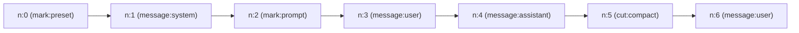
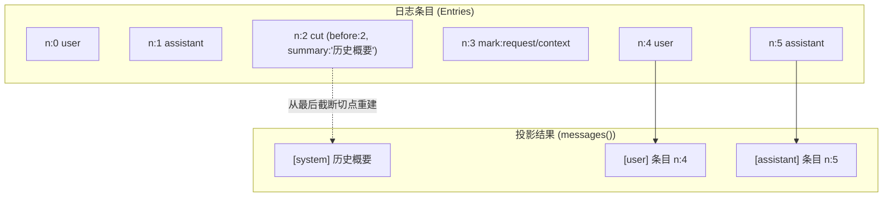
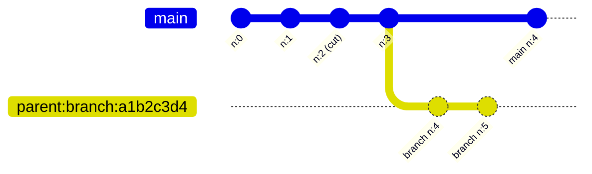

# 会话、消息与分支

::: tip
`ctx.sessions` 管理底层的会话生命周期与历史。会话不是可以随意修改的消息列表，而是一份**只追加日志（Append-only Log）**：用户输入、模型回复、预设切换、压缩截断和各类元数据事件，都作为不可变条目依次追加。日志是系统状态的**唯一事实源**，发给模型的上下文是由它在运行时计算出的**投影（Projection）**。
:::

## 会话头部

每个会话由唯一的 `SessionId` 标识，存储层持有一份轻量的 `SessionHeader`：

| 字段 | 类型 | 说明 |
| :--- | :--- | :--- |
| `sessionId` | `string` | 会话全局唯一标识符 |
| `formatVersion` | `number` | 格式版本号，常量 `CURRENT_SESSION_FORMAT = 1` |
| `createdAt` | `number` | 创建时间的时间戳（毫秒） |
| `parent` | `string?` | 分支来源的父会话 ID（仅分支会话存在） |
| `at` | `number?` | 分支切出时在父会话中的条目序号（仅分支会话存在） |
| `delegationDepth` | `number` | 委派深度，主会话为 `0`；分支默认复制父会话的值，除非创建时显式指定 |
| `title` | `string?` | 会话的可选展示标题 |
| `origin` | `JsonValue?` | 任意 JSON 来源元数据（例如平台、路由或子代理来源） |

`delegationDepth` 不会自动递增：子代理由调用方显式传入深度，普通分支沿用父会话的值。

## 条目

每个条目都有：

- `n`：从 `0` 开始严格连续递增的序号。
- `time`：毫秒时间戳。

按 `kind` 分为三类：`message`（对话消息 `ChatMessage`）、`mark`（管线标记、元数据与调度记录）、`cut`（截断与摘要切点）。



`message` 条目的 `meta`：

- `turn`：所属轮次。
- `step`：轮次内的执行步骤（如工具调用的多步循环）。
- `usage`：`inputTokens`、`outputTokens`、`totalTokens`。
- `finish`：停止原因，如 `stop`、`tool_calls`、`length`。
- `timing`：各阶段耗时，如首字延迟、解码耗时。

## 标记（mark）

`mark` 条目记录上下文变更、调度决策与输入审计，**不会作为消息发给模型**。

| Mark 名称 | Data 载荷结构 | 作用说明 |
| :--- | :--- | :--- |
| `prompt` | `PromptSnapshot`（包含 `ChatEpochHeader` 与 `turn/step/reason/sources`） | 记录当前生成的 Prompt 快照与派生上下文 |
| `preset/selected` | `{ presetId: string, revision: string }` | 记录会话绑定或切换预设的版本 |
| `request/context` | `{ provider: string, model: string, contextWindow?: number }` | 记录推理请求的目标供应商、模型与窗口大小 |
| `agent/input-enqueued` | `{ messageId: string, message: any, target: 'next-turn' \| 'next-step', wakeup: boolean, enqueuedAt: number }` | 记录 Agent 输入排队入队事件 |
| `agent/input-admitted` | `{ messageId: string, n: number }` | 记录排队的输入被调度引擎正式采纳写入日志 |
| `agent/input-discarded` | `{ messageId: string, reason: string }` | 记录过时、冲突或被丢弃的输入消息 |
| `turn-skip` | `{ reason: string, detail?: string, turn?: number }` | 跳过当前轮次，自带 `turn` 以标记位置 |

`prompt` 快照会根据 `provider`、`model`、`reasoningEffort`、`temperature`、`maxTokens`、`stop`、`system`、`prelude` 和 `tools` 计算规范化 JSON 哈希 `promptDigest`，用于判定 Epoch 边界和缓存是否有效。

## 写入与并发

1. **expectedN**：写入前按内存中的条目数确定下一个期望序号。
2. **乐观锁**：`store.put(sessionId, expectedN, entries)` 批量持久化，底层条目已变化时拒绝写入：
   ```ts
   throw new SessionConflictError(sessionId, expectedN, actualN)
   ```
3. **串行队列**：同一会话实例的 `write`、`commit`、`mark`、`compact` 进入串行 Promise 队列，防止进程内乱序。
4. **commit**：只允许提交 `assistant` 消息，追加成功后清理草稿（draft）。
5. **checkInvariants**：供 doctor 或导出工具显式调用，不在每次写入时执行。检查序号从 `0` 起严格连续、`cut.before` 是 `[0, n]` 内的非负整数、载荷可以安全序列化为 JSON。

## 投影



- **`messages()`**：找到最后一个 `cut`，以 `cut.summary` 为起点，拼接其后的全部 `message` 条目；没有 `cut` 时返回全部 `message`。
- **缓存**：内存中维护 `cachedAt`，仅当 `cachedAt !== entryList.length` 时重算；遇到 `cut` 强制全量重算。
- **软截断**：早于 `cut.before` 的条目仍完整保留在日志中，审计和回溯不丢信息。
- **请求重建**：`reconstructRequest(atN)` 根据序号 `atN` 处的 `prompt` 标记和上下文快照，复原当时发给模型的请求。

## 分支

可以在任意历史位置切出独立的新分支，用于探索不同的生成方向或调试子代理。



- `branch(at, options)`，要求 `0 <= at <= entryList.length`。
- 子会话复制父会话 `0..at` 的全部条目。
- 头部的 `parent` 为父会话 ID，`at` 为切出序号，`delegationDepth` 默认复制父会话，可显式指定。
- 未指定 ID 时生成 `<parent>:branch:<8位hex>`（UUID 前 8 位）。
- 成功后触发 `chatluna/session-branch`，载荷 `{ parent, session, at }`。

## 压缩切点

压缩器调用 `compact` 插入 `cut` 条目：

```ts
interface CutEntryData {
  before: number          // 截断生效点，处于 [0, n]
  summary: ChatMessage[]  // 折叠旧历史得到的消息序列（通常是摘要消息）
  reason: string          // 触发压缩的原因（如 token_limit, manual）
  native?: unknown        // Provider 专属的原生压缩块（可能包含 unusable 状态）
  meta?: Record<string, unknown> // 额外诊断元数据
}
```

- `compact` 也是通过 `write` 写入的普通条目。
- `native` 保存厂商原生的压缩块，失效或标记为 `unusable` 时投影降级使用 `summary`。
- 写入 `cut` 后，`messages()` 忽略此前的条目，从 `summary` 开始重组。

## 存储契约

```ts
interface SessionStore {
  head(id: SessionId): Promise<SessionHead | undefined>
  read(id: SessionId, from?: number): Promise<readonly SessionEntry[]>
  put(id: SessionId, expectedN: number, entries: readonly SessionEntry[]): Promise<void>
  create(header: SessionHeader, entries?: readonly SessionEntry[]): Promise<void>
  list?(options?: { parent?: SessionId; limit?: number }): Promise<readonly SessionHeader[]>
  delete?(id: SessionId): Promise<boolean>
}
```

- **默认**：内置 `MemorySessionStore`，适合测试和无状态运行。
- **持久化**：生产环境加载 `@chatluna/session-persistence-sqlite`，它注册 `session_store` 服务，提供 SQLite 后端。
- **临时释放**：没有注册 `session_store`（只有内存存储）时，系统会适时调用 `releaseIfEphemeral` 释放临时会话，防止内存泄漏。

## 服务 API

- **`open(sessionId)`**：`store.head` 存在则读取全部条目返回实例，不存在则隐式 `create`。**每次 `open` 返回独立的快照实例**，并发写入冲突在 `store.put` 时暴露。
- **`create(id?, options)`**：创建会话。传入 `parent` 与 `at` 时复制父会话切点之前的条目；`delegationDepth`、`origin`、`title` 未指定时沿用父会话。
- **`branch(sessionId, at, options)`**：在指定序号分叉。
- **`list()`**：列出所有会话头部。
- **`head(sessionId)`**：只读头部，不加载条目。
- **`delete(sessionId)`**：删除会话及全部条目。
- **`define(markName, schema)`**：注册自定义 mark 的校验 Schema。

错误类型：

- `SessionConflictError`：并发追加导致序号不匹配（含 `sessionId`、`expectedN`、`actualN`）。
- `SessionNotFoundError`：会话不存在。
- `SessionAlreadyExistsError`：会话已存在。
- `SessionError`：基类。

## 与其他子系统的关系

- **`conversations`**：维护会话键到当前 `SessionId` 的映射。
- **`agents`**：打开会话、组装执行环境，循环中写入 `message` 和 `agent/*` 标记。
- **压缩**：监控上下文用量，计算摘要并写入 `cut`。
- **链路追踪**：通过条目的 `meta` 和 `mark:prompt` 关联耗时与 Token 开销。
- **诊断**：`doctor session <id>` 遍历条目并校验日志不变量（序号连续、切点边界、可序列化）。

## 下一步

- [会话索引与活跃 Agent](./conversations) — 会话键与 Head 管理。
- [Agent 执行模型](./agents) — Agent 如何读写会话。
- [上下文与缓存](./context-cache) — 基于 PromptSnapshot 的缓存复用。
- [消息管线](./chat-pipeline) — 消息从接收到推理的完整链路。
