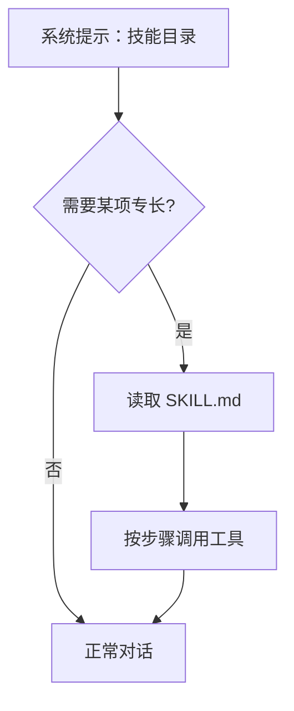

# 技能系统

::: tip
技能（Skill）本质上是写给大语言模型阅读的操作手册。它解决的核心问题不是模型「有没有某项能力」，而是「面对具体任务时应该按照什么标准步骤来做」。
:::

拥有丰富的工具，并不代表模型能够合理运用它们。

在实际使用中，我们经常会遇到这种情况：模型即便拿到了读取文件、写入文件和执行命令等一系列工具，面对一项只需几分钟的任务，也容易绕路执行十几个琐碎操作，中途甚至还会漏掉最基础的校验步骤。

消除这种能力与落地差距的有效手段，并不是无休止地堆叠新工具，而是为模型提供一份结构清晰的标准作业说明。这就是技能系统的由来。

<!-- 架构页，可以使用代码与配置示意 -->

## 一份技能是什么

一个规范的技能目录中，根目录下至少需要包含一份 `SKILL.md` 文件：

```markdown
---
name: release-notes
description: 从一个项目的提交记录生成发布说明
version: 1.2.0
platforms: [linux, darwin]
env:
  GITHUB_TOKEN:
    description: 用于读取提交记录
    secret: true
    required: true
---

# 什么时候用

当用户要求「整理这次发布的内容」时使用。

# 步骤

1. 读取最近两次 tag 之间的提交。
2. 按类型分组：新功能、修复、其他。
3. 用用户的语言重写每条提交，不要照抄。
4. 输出 Markdown 列表。

# 失败处理

如果拿不到提交记录，告诉用户缺什么，不要编造。
```

### 元数据

`SKILL.md` 顶部的 YAML Frontmatter 声明了该技能的基础配置与运行时约束：

| 字段 | 作用 |
| --- | --- |
| `name` | 技能标识，通常用小写短横线 |
| `description` | 一句话说明，会进入技能目录 |
| `version` / `author` / `license` | 来源信息 |
| `platforms` | 适用的操作系统 |
| `environments` | 适用的运行环境 |
| `env` | 需要的环境变量，可标记密钥、必需、默认值 |

其中，`description` 是模型在日常对话中判断「当前场景是否需要读取该技能」的唯一直接依据。如果写得过于模糊（例如「处理数据的技能」），模型就很难在合适的时机主动调用它。

## 目录与发现

运行时会从多个来源发现并收集可用的技能：

| 来源 | 位置 | 特点 |
| --- | --- | --- |
| 工作区 | 当前 Agent 的工作目录 | 优先级最高，随项目走 |
| 内置 | 随插件分发 | 只读，开箱即用 |
| 宿主机目录 | 数据目录或配置的路径 | 跨实例共享 |
| 用户自定义 | 数据目录下的自定义目录 | 界面里新建或复制的放这里 |

当不同来源中出现同名技能时，系统不会合并它们的属性，而是严格按照来源优先级选取最高的一项，其余同名技能会被标记为「被遮蔽」（Shadowed）。

加载优先级的判定顺序从高到低依次为：工作区 → 内置 → 宿主机目录 → 用户自定义。

::: warning
「内置」优先于「宿主机目录」的设定可能有些反直觉。

如果你修改了宿主机目录下与内置技能同名的文件，却发现改动没有生效，通常是因为它被内置技能覆盖了。此时建议复制并重命名该技能，或者在控制台界面中检查具体的遮蔽关系。
:::

### 市场

启用技能市场后，你可以直接搜索并一键安装社区贡献的技能包。

通过市场安装的技能会存放在宿主机目录中，与本地现有的宿主技能遵循完全相同的优先级规则参与排序与发现。

## 渐进披露

技能机制最关键的设计并不在于文件格式本身，而在于按需加载的「渐进披露」（Progressive Disclosure）策略。

在大多数常规对话中，模型在系统提示词中只能看到一份精简的**技能目录**，仅包含每个技能的 `name` 和简要的 `description`。

只有当模型根据用户输入判断确实需要加载某项专长时，才会通过工具主动拉取对应技能的正文内容。读取到的 `SKILL.md` 正文仅会注入当前轮次的会话上下文，不会常驻在全局系统提示词中。



这种按需读取的方式既能支持安装海量技能，又不会撑爆日常轻量对话的上下文窗口。

当然，这也意味着模型每次调用技能前都需要额外消耗一次上下文读取开销。对于超高频调用的核心能力，在设计时需要权衡其接入形式。

::: tip
技能目录本身也会占用一部分系统提示词空间。

当安装的技能达到数百个时，即便完全不展开正文，单纯的目录清单也会变得相当冗长。因此，定期清理不再使用的技能依然是维护上下文健康的最佳实践。
:::

## 技能工具

为了让模型能够自如地操作技能，系统在底层统一提供了一组专属工具：

- **列出/搜索技能**：用于在运行时按需检索技能目录。
- **读取技能**：用于读取指定技能的 `SKILL.md` 正文。
- **读取文件**：用于读取技能目录内附带的参考说明或模板文件。
- **运行脚本**：用于在受控环境中执行技能目录下的关联脚本。

模型只能借助这些标准化工具与技能交互，无法直接穿透访问宿主机的底层文件系统。

这也意味着对技能的访问受到工具可见性机制的统一管控。例如，当特定场景的规则禁用了技能工具时，模型在当前会话中将完全感知不到任何技能。

## 脚本与环境变量

除了纯文本说明，复杂的技能还可以内嵌可执行脚本。

当模型请求执行技能脚本时，运行时会经历以下流程：

1. **确定执行位置**：在当前绑定到该 Agent 的目标环境或容器中启动执行。
2. **注入变量**：将技能元数据中声明的环境变量与配置值注入到脚本运行环境。
3. **权限校验**：根据当前会话的安全级别与权限模式，判断是否需要人工审批确认。
4. **回传输出**：收集标准输出与错误日志，并将执行结果格式化后写回模型上下文。

### 密钥

技能声明的环境变量可以单独打上密钥（Secret）标记。

被标记为密钥的变量值会受到脱敏保护，既不会明文注入模型的提示词上下文，也不会被记录在常规运行日志中。

在权限管理层面，调用带有密钥的技能属于敏感行为。系统默认要求调用方具备 4 级权限，并且在执行前会作为高危操作触发二次确认。

::: warning
切勿将明文密钥直接写在 `SKILL.md` 正文或说明文档中。

直接把 Secret 写在正文里，等同于向所有能够读取该技能的模型公开了敏感凭据。正确的做法是在 Frontmatter 的 `env` 节点声明变量，正文仅保留对该环境变量名的引用。
:::

### 环境匹配

技能可以通过 `platforms` 和 `environments` 字段声明自身适用的宿主平台与执行环境。

系统在收集技能阶段会自动根据当前运行环境进行过滤：例如在 macOS 节点上，标记为仅适用于 Windows 的技能会被自动忽略。

若这两个字段保留为空，则表示该技能具备跨平台通用性，匹配所有运行环境。

## 技能的局限

尽管技能赋予了模型条理化的操作指引，但在使用时仍需明确它的边界：

- **技能不会自动执行**：技能本质上是一份操作指引，所有的实际动作仍旧依赖模型去理解并主动发起工具调用。
- **技能不能保证完全被遵守**：模型存在理解偏差或跳步的可能。正文中的步骤定义得越具体、校验条件越严密，模型的执行依从率就越高。
- **技能不是业务代码的替代品**：对于高确定性、逻辑复杂的业务流程，应当直接封装为独立的脚本让模型单步调用，而不是将全部控制流写在正文中让模型逐步推理。
- **技能无法绕过系统权限**：任何由技能触发的脚本运行或敏感密钥注入，依然必须严格经过既有的权限检查与审批链路。

## 配置

技能插件提供了以下主要配置项，方便按需调整发现与加载行为：

| 配置 | 作用 |
| --- | --- |
| 内置技能 | 是否加载随插件分发的技能 |
| 宿主技能目录 | 目录列表与各自的优先级 |
| 工作区技能目录 | 额外的工作区路径 |
| 提示词技能清单 | 是否把目录写进系统提示 |
| 生效环境 | 当前环境名，用于过滤 |
| 市场 | 是否启用，以及端点 |

如果关闭了「提示词技能清单」，系统将不再把技能目录预先注入到全局提示词中。此时模型只能依赖搜索工具主动探索技能——通常并不推荐这样配置，因为模型往往无法预判应该使用哪些关键词来检索未知的技能。

## 自进化

框架还提供了一个可选的自进化扩展插件，允许模型在完成复杂任务后，自动将验证有效的方案总结并提取为草稿技能。

其演进遵循严格的发布流程：`草稿` → `测试` → `审查` → `安装` → `可回滚`。

出于生产稳定性考量，自进化插件默认处于未安装状态。在缺少该插件的环境中，技能注册表保持只读特性，你只能通过手动导入、直接编辑配置文件或通过应用市场来新增和变更技能。

::: tip
技能自进化虽然方便，但在实际落地时仍需保持审慎。

模型自动总结出的经验在语义上可能显得十分合理，但细节处往往潜藏隐蔽的缺陷。所有由模型生成的草稿技能，在合入生产实例之前务必经过严格的人工审查与离线验证。
:::

## 与工具、MCP 的关系

在理解系统的扩展体系时，可以清晰地划分它们各自的职责：

- **工具**：代表模型能够调用的具体原子动作。
- **技能**：代表指导模型如何组合运用工具的标准作业方法。
- **MCP**：代表外部生态能力与异构服务接入框架的统一协议通道。

换句话说，一份技能可以编排并指导模型连续调用多个底层工具；而 MCP 则负责将三方外部工具无缝汇聚到全局工具箱中；技能本身同样可以调用由 MCP 提供的扩展工具。

无论是本地内置工具还是通过 MCP 接入的远程工具，在与技能配合使用时均遵循完全一致的权限校验与审批机制。

## 排查

在开发或配置技能遇到问题时，可以参考以下常见情况进行排查：

**模型不知道有这个技能。**
请检查技能文件是否被正确放置并发现；检查是否存在更高优先级的同名技能导致当前技能被遮蔽；核对 `platforms` 与 `environments` 是否过滤掉了当前环境；同时确认会话场景中是否放通了技能相关工具的调用权限。

**加载了技能却不按步骤做。**
通常是因为技能正文的描述过于抽象。建议将触发时机明确标注在开头，对操作步骤进行严格编号，并为关键步骤提供量化的验证断言与失败兜底预案。

**脚本报错提示缺少变量。**
检查 `SKILL.md` 中 Frontmatter 的环境变量声明，确保必需项未遗漏；同时排查当前会话的权限策略是否阻断了敏感密钥的注入。

**导入后没有生效。**
很大可能是由于存在更高优先级的同名技能（如内置技能）对其形成了遮蔽。可以在管理界面中查看遮蔽关系，通过重命名技能或清理冲突条目解决。

**技能占用了过多上下文。**
表明单份技能的正文内容过于冗长。建议将复杂的技能拆解为多个细粒度的轻量技能，或将冗长的技术说明下沉到技能目录中的静态辅助文件，正文仅保留关键入口与步骤。

## 下一步

现在，你已经掌握了技能系统的核心架构与运作机制。接下来可以根据需求进一步探索：

- [技能](/manual/usage/skills) — 面向使用者的导入与管理。
- [工具系统](./tools) — 技能调用的是什么。
- [MCP](./mcp) — 外部工具的接入。
- [提示词装配](./prompts) — 技能目录是怎么进入系统提示的。
