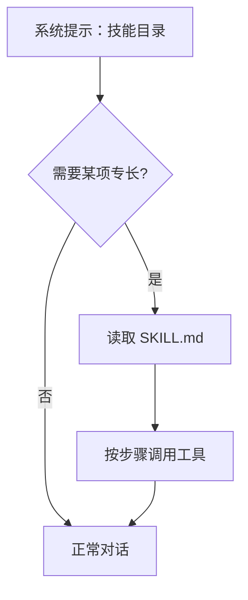

# 技能

::: tip
技能是写给模型看的操作手册。它解决的不是「有没有这个能力」，而是「这件事应该按什么步骤做」。
:::

工具很多、能力很强，不代表模型会用。

一个常见的失败场景是：模型手里有读文件、写文件、跑命令三样工具，却把一件五分钟能做完的事拆成了十几步绕路操作，中间还漏掉了验证。

补上这个差距的办法不是再加工具，而是给它一份说明书。

这就是技能。

<!-- 架构页，可以使用代码与配置示意 -->

## 一份技能是什么

一个技能目录至少包含一个 `SKILL.md`：

```markdown
---
name: release-notes
description: 从一个项目的提交记录生成发布说明
version: 1.2.0
platforms: [linux, darwin]
env:
  GITHUB_TOKEN:
    description: 用于读取提交记录
    secret: true
    required: true
---

# 什么时候用

当用户要求「整理这次发布的内容」时使用。

# 步骤

1. 读取最近两次 tag 之间的提交。
2. 按类型分组：新功能、修复、其他。
3. 用用户的语言重写每条提交，不要照抄。
4. 输出 Markdown 列表。

# 失败处理

如果拿不到提交记录，告诉用户缺什么，不要编造。
```

### 元数据

| 字段 | 作用 |
| --- | --- |
| `name` | 技能标识，通常用小写短横线 |
| `description` | 一句话说明，会进入技能目录 |
| `version` / `author` / `license` | 来源信息 |
| `platforms` | 适用的操作系统 |
| `environments` | 适用的运行环境 |
| `env` | 需要的环境变量，可标记密钥、必需、默认值 |

`description` 是模型判断「要不要加载」的唯一依据。写成「处理数据的技能」几乎等于没写。

## 目录与发现

技能从多个来源被发现：

| 来源 | 位置 | 特点 |
| --- | --- | --- |
| 工作区 | 当前 Agent 的工作目录 | 优先级最高，随项目走 |
| 内置 | 随插件分发 | 只读，开箱即用 |
| 宿主机目录 | 数据目录或配置的路径 | 跨实例共享 |
| 用户自定义 | 数据目录下的自定义目录 | 界面里新建或复制的放这里 |

同名技能不会合并，而是按来源优先级取一个，其余标记为「被遮蔽」。

优先级从高到低是：工作区 → 内置 → 宿主机目录 → 用户自定义。

::: warning
「内置优先于宿主机目录」这一点和直觉相反。

如果你改了一份与内置技能同名的技能却没生效，多半就是被内置的那份遮住了。复制并改名，或者在界面上查看覆盖关系。
:::

### 市场

如果启用了技能市场，可以搜索并安装社区技能。

市场安装的技能落在宿主机目录，和本地技能一样参与排序。

## 渐进披露

技能最重要的设计不是格式，而是加载方式。

模型平时只看到一份**目录**：每个技能的名字和一句描述。

只有当它判断需要某个技能时，才会读取正文。正文进入当前回合的上下文，不会永久留在系统提示里。



这样做的好处是可以装很多技能，而不会拖垮日常对话。

代价是每次使用都要先读一次——对于高频技能，这个成本需要权衡。

::: tip
目录本身也占上下文。

技能装到几百个时，即使正文不加载，目录也会变得很长。定期清理不用的技能，比什么都管用。
:::

## 技能工具

技能系统对外暴露一组工具：

- **列出/搜索技能**：查询目录。
- **读取技能**：读取正文。
- **读取文件**：读取技能目录里的其他文件。
- **运行脚本**：执行技能里的脚本。

模型通过这些工具操作技能，而不是直接访问文件系统。

这也意味着技能的访问受工具可见性控制：场景规则禁用技能工具之后，模型就看不到任何技能。

## 脚本与环境变量

技能可以带脚本。

脚本执行时：

1. 在绑定到该 Agent 的机器上运行。
2. 注入技能声明的环境变量。
3. 按权限模式决定是否需要审批。
4. 捕获输出并返回给模型。

### 密钥

环境变量可以标记为密钥。

密钥的值不会出现在模型上下文里，也不会出现在日志里。

启用技能密钥是一个独立的权限动作，默认要求 4 级，而且标记为危险。

::: warning
技能正文里不要写密钥。

把密钥写进 `SKILL.md`，等于把它交给每一个能读到这份技能的模型。用环境变量声明，正文只引用变量名。
:::

### 环境匹配

技能可以声明自己适用的平台与环境。

系统根据当前环境过滤技能：在 macOS 上，标记为 Windows 的技能不会出现。

留空表示匹配所有环境。

## 技能的局限

技能不是万能的，几个边界值得清楚：

**技能不会自动执行。**
它是一份说明，执行仍然要靠模型调用工具。

**技能不能保证被遵守。**
模型可能读了说明却不按步骤做。步骤写得越具体，遵守率越高。

**技能不是代码。**
复杂的确定性逻辑应该写成脚本，让模型调用，而不是写在正文里让模型推理。

**技能不能绕过权限。**
脚本执行、密钥启用都走正常的权限判定。

## 配置

技能插件的主要配置：

| 配置 | 作用 |
| --- | --- |
| 内置技能 | 是否加载随插件分发的技能 |
| 宿主技能目录 | 目录列表与各自的优先级 |
| 工作区技能目录 | 额外的工作区路径 |
| 提示词技能清单 | 是否把目录写进系统提示 |
| 生效环境 | 当前环境名，用于过滤 |
| 市场 | 是否启用，以及端点 |

关闭「提示词技能清单」之后，目录不再进入系统提示，模型只能通过工具查询——通常不推荐，因为它根本不知道该查什么。

## 自进化

有一个可选插件，允许模型把成功的做法写成草稿技能。

流程是：草稿 → 测试 → 审查 → 安装 → 可回滚。

它默认不安装。没有它时，技能注册表是只读的：只能通过导入、编辑文件或市场安装来增加技能。

::: tip
这个功能听起来很诱人，但需要谨慎。

模型写出来的说明可能看起来合理、实际有错。草稿必须经过人工审查才能装进生产实例。
:::

## 与工具、MCP 的关系

- **工具**是动作。
- **技能**是方法。
- **MCP** 是外部能力的接入通道。

一个技能可以指导模型使用多个工具；MCP 可以把外部工具接进同一个工具集；技能也可以调用 MCP 工具。

它们的权限与审批规则完全一致。

## 排查

**模型不知道有这个技能。**

检查技能是否被发现、是否被同名技能遮蔽、是否被环境过滤、技能工具是否可见。

**加载了但不按步骤做。**

正文写得太抽象。把触发条件写在最前面，步骤编号，给出判断依据与失败处理。

**脚本报缺少变量。**

检查环境变量声明，补上必需项；确认当前场景允许启用密钥。

**导入后没生效。**

大概率被更高优先级的同名技能遮住了。看覆盖关系，改名字或者删掉其中一个。

**上下文被技能撑爆。**

技能正文太长。拆成多个小技能，或者把细节放到技能目录的参考文件里，正文只留入口。

## 下一步

- [技能](/manual/usage/skills) — 面向使用者的导入与管理。
- [工具系统](./tools) — 技能调用的是什么。
- [MCP](./mcp) — 外部工具的接入。
- [提示词装配](./prompts) — 技能目录是怎么进入系统提示的。
