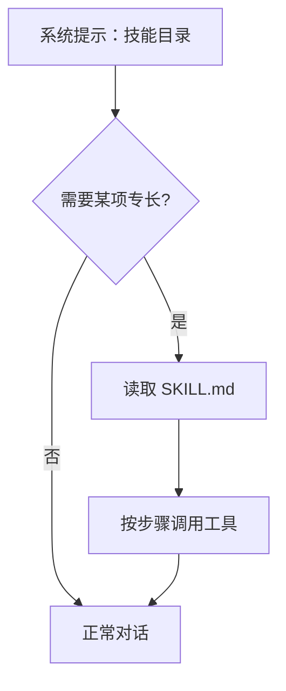

# 技能系统

::: tip
技能（Skill）是写给模型的操作手册。它要解决的不是模型「有没有某项能力」，而是「面对具体任务该按什么步骤做」。模型拿到读写文件、执行命令等工具后，常常绕路做十几步琐碎操作，还漏掉基本校验。解决办法不是堆更多工具，而是给它一份清晰的作业说明。
:::

<!-- 架构页，可以使用代码与配置示意 -->

## 一份技能是什么

技能目录的根下至少有一份 `SKILL.md`：

```markdown
---
name: release-notes
description: 从一个项目的提交记录生成发布说明
version: 1.2.0
platforms: [linux, darwin]
env:
  GITHUB_TOKEN:
    description: 用于读取提交记录
    secret: true
    required: true
---

# 什么时候用

当用户要求「整理这次发布的内容」时使用。

# 步骤

1. 读取最近两次 tag 之间的提交。
2. 按类型分组：新功能、修复、其他。
3. 用用户的语言重写每条提交，不要照抄。
4. 输出 Markdown 列表。

# 失败处理

如果拿不到提交记录，告诉用户缺什么，不要编造。
```

| 字段 | 作用 |
| --- | --- |
| `name` | 技能标识，通常用小写短横线 |
| `description` | 一句话说明，会进入技能目录 |
| `version` / `author` / `license` | 来源信息 |
| `platforms` | 适用的操作系统 |
| `environments` | 适用的运行环境 |
| `env` | 需要的环境变量，可标记密钥、必需、默认值 |

`description` 是模型判断是否读取该技能的唯一直接依据。写成「处理数据的技能」这样模糊的描述，模型很难在合适时机想起它。

## 发现

| 来源 | 位置 | 特点 |
| --- | --- | --- |
| 工作区 | 当前 Agent 的工作目录 | 优先级最高，随项目走 |
| 内置 | 随插件分发 | 只读，开箱即用 |
| 宿主机目录 | 数据目录或配置的路径 | 跨实例共享 |
| 用户自定义 | 数据目录下的自定义目录 | 界面里新建或复制的放这里 |

同名技能不会合并，按优先级「工作区 → 内置 → 宿主机目录 → 用户自定义」取最高的一个，其余标记为被遮蔽（Shadowed）。

::: warning
内置优先于宿主机目录。改了宿主机目录下与内置同名的技能却不生效，通常是被内置技能遮蔽了。复制并重命名，或在控制台查看遮蔽关系。
:::

**市场**：启用后可以搜索并安装社区技能，安装到宿主机目录，按相同的优先级参与发现。

## 渐进披露

技能的关键在于按需加载（Progressive Disclosure）。系统提示词中只有一份**技能目录**，每项只有 `name` 和 `description`。模型判断需要某项专长时才通过工具读取正文，正文只注入当前轮次的上下文，不常驻系统提示词。



这样可以安装大量技能而不撑爆日常对话的上下文，代价是每次使用前要多一次读取。高频核心能力需要权衡接入方式。

::: tip
目录本身也占系统提示词。装了数百个技能时，光是目录就很长，定期清理不用的技能。
:::

## 技能工具

- **列出/搜索技能**：运行时检索技能目录。
- **读取技能**：读取 `SKILL.md` 正文。
- **读取文件**：读取技能目录中的参考说明或模板。
- **运行脚本**：在受控环境中执行技能目录下的脚本。

模型只能通过这些工具访问技能，不能直接访问宿主机文件系统。所以技能受工具可见性管控：场景规则禁用了技能工具时，模型完全看不到技能。

## 脚本与环境变量

执行技能脚本时：

1. **确定位置**：在当前 Agent 绑定的环境或容器中执行。
2. **注入变量**：注入元数据中声明的环境变量和配置值。
3. **权限校验**：按会话的安全级别和权限模式判断是否需要审批。
4. **回传输出**：收集标准输出和错误，格式化后写回模型上下文。

**密钥**：标记为 Secret 的变量会脱敏，不进入模型上下文，也不写入常规日志。调用带密钥的技能默认需要 4 级权限，并作为高危操作触发二次确认。

::: warning
不要把明文密钥写在 `SKILL.md` 正文里，那等于公开给所有能读这个技能的模型。在 Frontmatter 的 `env` 中声明，正文只引用变量名。
:::

**环境匹配**：收集技能时按 `platforms` 和 `environments` 过滤，例如 macOS 上忽略仅限 Windows 的技能。两个字段留空表示通用。

## 局限

- **不会自动执行**：技能只是指引，动作仍由模型发起工具调用。
- **不保证被遵守**：模型可能理解偏差或跳步。步骤越具体、校验越严密，依从率越高。
- **不替代业务代码**：确定性高、逻辑复杂的流程应封装成脚本让模型单步调用，而不是让模型按正文逐步推理。
- **不能绕过权限**：技能触发的脚本和密钥注入照常经过权限检查与审批。

## 配置

| 配置 | 作用 |
| --- | --- |
| 内置技能 | 是否加载随插件分发的技能 |
| 宿主技能目录 | 目录列表与各自的优先级 |
| 工作区技能目录 | 额外的工作区路径 |
| 提示词技能清单 | 是否把目录写进系统提示 |
| 生效环境 | 当前环境名，用于过滤 |
| 市场 | 是否启用，以及端点 |

关闭「提示词技能清单」后，模型只能靠搜索工具发现技能。不推荐，因为模型往往猜不到该用什么关键词检索未知技能。

## 自进化

可选的自进化插件允许模型在完成复杂任务后，把验证有效的方案提取为草稿技能，流程为 `草稿` → `测试` → `审查` → `安装` → `可回滚`。

它默认不安装。没有它时技能注册表是只读的，只能手动导入、直接编辑文件或从市场安装。

::: tip
模型总结的经验可能看起来合理但细节有缺陷。草稿技能进入生产实例前务必经过人工审查和离线验证。
:::

## 与工具、MCP 的关系

- **工具**：模型能调用的原子动作。
- **技能**：指导模型如何组合工具的方法。
- **MCP**：接入外部服务的协议通道，把第三方工具汇入工具箱。

技能可以编排多个工具，包括 MCP 提供的工具；它们都走同一套权限与审批。

## 常见问题

**模型不知道有这个技能**：检查技能是否被发现、是否被同名技能遮蔽、`platforms` 与 `environments` 是否过滤掉了当前环境，以及场景规则是否放通了技能工具。

**加载了技能却不按步骤做**：正文太抽象。开头写明触发时机，步骤严格编号，关键步骤给出验证条件和失败预案。

**脚本提示缺少变量**：检查 Frontmatter 中的 `env` 声明是否完整，以及权限策略是否阻止了密钥注入。

**导入后没生效**：多半被更高优先级的同名技能遮蔽，在管理界面查看后重命名或清理冲突。

**技能占用太多上下文**：正文太长。拆成多个小技能，或把长说明移到技能目录中的辅助文件。

## 下一步

- [技能](/manual/usage/skills) — 面向使用者的导入与管理。
- [工具系统](./tools) — 技能调用的是什么。
- [MCP](./mcp) — 外部工具的接入。
- [提示词装配](./prompts) — 技能目录是怎么进入系统提示的。
