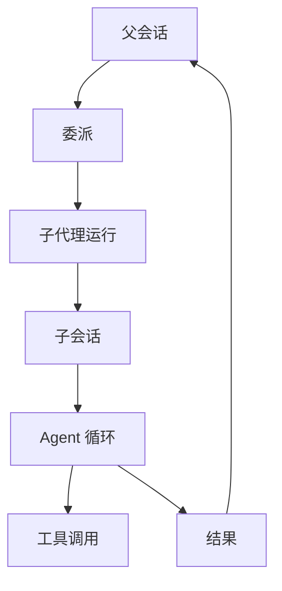

# 子代理系统

::: tip
子代理是「另一个上下文里的自己」。它拥有独立的会话、执行循环、工具集和模型配置，在完成委派任务后只将最终结果带回父会话。
:::

在多步自动化与复杂排查场景中，主代理的上下文窗口是非常宝贵的资源。

一次深度的代码排查往往需要阅读数十个文件、执行多次命令行调用并分析多份运行日志。如果把这些冗长的中间交互全部保留在主会话中，当准备向用户输出最终答复时，上下文窗口早已被这些过程数据占满。

子代理的核心设计初衷，就是将「执行过程」与「最终结论」分离开来。

## 运行模型

一次子代理运行通常由以下要素构成：

- **配置**：指定使用的 profile、执行后端、模型档位及工具集合。
- **会话**：独立的子会话实例，拥有自成一体的上下文与运行日志。
- **运行体**：任务的承载实体。在默认内部后端中表现为一个完整的 Agent 实例，而在外部后端中则对应一个独立的系统进程。
- **结果**：产出的最终状态、文本输出或结构化数据，以及对应的 Token 用量统计。

子代理的运行流转关系如下所示：

## Profile

Profile 是子代理的配置模板，用于预先声明该子代理的能力特征与运行约束：

| 字段 | 作用 |
| --- | --- |
| `name` | 名字，用于委派时指定 |
| `description` | 让模型知道这个子代理适合什么 |
| `backend` | 执行后端，默认是内部 Agent |
| `engine` | 默认后端挂载的引擎，默认 `agent` |
| `tools` | 工具过滤 |
| `model` | 具体模型或模型档位 |
| `maxLevel` | 允许使用的最高档位 |
| `machine` | 执行机器 |
| `mode` | 权限模式 |
| `prompt` | 额外的系统提示 |
| `output` | 结构化输出结构 |
| `inherit` | 继承父会话上下文的方式 |
| `lifetime` | 一次性或可续 |

系统中的 Profile 由扩展插件注册。在执行过程中，系统提示词会动态列出当前可用的 profile 清单，主模型据此评估并将任务委派给最合适的子代理。

::: tip
Profile 列表的变更不会改变底层工具集的定义数组，而是通过系统提示词与通知消息告知模型。

这样在动态增加或调整 profile 时，不会导致上游的大模型 Prompt 缓存前缀失效。
:::

## 继承

默认情况下，子代理处于完全隔离的状态，仅能看到委派给它的具体任务说明。

框架提供了三种上下文继承方式：

| 方式 | 子代理看到 |
| --- | --- |
| `none` | 只有任务（默认行为） |
| `summary` | 父会话压缩后的摘要 + 任务 |
| `fork` | 父会话的对话记录 + 任务 |

如果采用 `summary` 方式，系统会依赖运行时的会话压缩能力；当压缩功能不可用时，系统会自动降级为 `none` 模式并记录告警。采用 `fork` 方式时，系统会把父会话的历史对话记录作为一段引用材料放在最前面。

::: warning
无论选用上述哪种继承方式，父会话中的工具调用过程和工具返回结果均不会被子代理看到。

如果子代理需要知晓某个前置命令的输出结果，必须把关键内容显式写进任务说明中。
:::

## 生命周期

根据任务诉求的不同，子代理分为两种生命周期模式：

### 一次性

任务运行完毕即结束。外部后端全部属于这种模式，适合单次执行的独立任务。

### 可续

子会话会被完整保留下来，后续可以使用对应的运行 ID 重新唤醒并继续对话。

在同一个父会话下，同名 profile 同时只能有一个实例在运行。如果需要并行执行多个子任务，应当使用不同的 profile。

当父会话关闭时，关联的可续运行实例会被统一释放；相关执行数据与产出结果仍会保留在轨迹日志中。

## 深度

子代理之间支持嵌套委派，即一个子代理可以在自身执行过程中继续委派新的子代理。

为了防止产生无限嵌套的循环，系统通过深度限制来控制委派层级：

- 最外层的主会话深度定义为 `0`。
- 每完成一次委派，深度加一。
- 达到上限时，新的委派申请将被直接拒绝。

默认的深度上限是 `4`，这意味着最深可以执行到第 3 层子代理。这里的深度是从最外层父会话开始全局累计的，并不是按当前会话单独计算。

## 模型与档位

子代理支持配置专属的模型策略，通常包含两种指定维度：

- **档位**：小、中、大三档。
- **具体模型**：直接指定某个具体的模型地址。

模型解析时遵循如下优先级顺序：profile 指定的具体模型 → 调用时指定的档位 → profile 默认的档位 → 路由配置的默认档位 → 全局默认。

此外，实际生效的模型档位还会受到两层上限约束：一是 profile 自身的最高档位 `maxLevel`，二是路由配置中所允许的最高档位。

::: tip
子代理是独立的会话，Token 资源用量也是独立核算与统计的。

子代理的默认档位是「中」。如果委派的任务相对简单、小模型即可胜任，将默认档位调低即可节省成本。
:::

## 权限

子代理不会自动继承父会话的权限提升。

在权限体系中，子代理拥有属于自己的独立权限主体（通常是发起委派的用户）。在判定规则上，子代理的模式只会更严格，不会更宽松。

外部后端更加敏感：启动它们默认需要最高权限等级，属于系统中的高危动作。

::: warning
不要指望通过子代理绕过安全限制。

权限判定机制会对子代理的每一次工具调用重新执行校验，相应的规则、模式与等级限制一样会严格生效。
:::

## 执行环境

子代理可以指定任务运行的具体机器环境。

若未显式指定 `machine`，默认继承父代理的目标机器；若显式指定，该机器必须在当前用户可用的机器授权范围内，否则委派请求会被直接拒绝。

外部后端调用的命令行同样通过配置的机器执行，因此你可以借此机制安全地将它们放进沙箱环境中运行。

## 后台运行

对于耗时较长的工作流，子代理支持将任务平滑转入后台执行：

- 委派调用发起后，会立刻向父会话返回「已转后台」的结果。
- 任务进入后台任务列表，并拥有独立的输出日志。
- 当任务完成、失败或被取消时，会主动通知父会话。

若父会话主动发起取消操作，系统会通知子代理进行收尾，并释放当前持有的各类资源。

## 轨迹

每次子代理委派都会完整生成一条轨迹记录，其中包含：

- profile 名称与当前委派深度。
- 子会话 ID。
- 执行过程中使用的模型与工具调用明细。
- 任务耗时与 Token 用量统计。
- 最终结果或捕获的错误。

父会话的轨迹中只展示委派动作的起点与汇总结果，具体执行细节都保存在子代理自己的记录里。

这条边界在排查问题时非常重要：**父会话看不到预期答案时，先去看子代理的轨迹，判断是任务描述不清还是内部执行失败**。

## 外部后端

外部后端允许将子代理任务交由独立的命令行工具来执行：

- Claude CLI
- Codex CLI
- OpenCode
- Pi

系统适配层在中间承担桥梁职责：负责拼接调用命令、注入目标模型、流式解析输出、提取工具调用与最终结果，并统一处理超时与取消中断。

外部后端具备以下运行特征与限制：

- 均为一次性任务，不支持可续运行。
- 执行能力完全由对应的命令行工具自身决定。
- 默认拒绝权限提示，适合无人值守的自动化流程。
- 单次任务受到超时上限约束。

## 失败处理

子代理在执行中失败，并不会直接导致父会话失败。

委派工具会把错误包装成一个失败的调用结果返回给模型。收到错误后，模型可以自主决定后续策略——例如重试、换一个 profile，或者直接告知用户。

无论是深度超限、后端不存在、目标机器不允许访问，还是模型解析失败，都会以这种形式统一处理。

## 排查

在开发或配置子代理时，如果遇到异常情况，可以对照以下常见现象快速排查：

**模型不派子代理。**  
确认委派工具是否可见、已注册的 profile 列表是否非空，以及系统提示中是否有可用的子代理能力说明。

**子代理什么都不知道。**  
检查配置的继承方式 `inherit`。默认行为是不继承（`none`），子代理只有任务说明。如果确实需要上下文，请切换为摘要（`summary`）或分叉（`fork`）。

**接着聊接不上。**  
只有可续运行支持通过 ID 续聊，且必须满足同一个父会话、同一个 profile 的前置条件。

**子代理的结果很差。**  
多数是任务描述的问题。请把目标、约束及必要信息完整写进任务说明，不要假设它能看见父会话历史的工具结果。

**外部后端超时。**  
建议先确认命令行工具能在终端里正常运行，再检查登录状态、网络环境与超时配置。

## 下一步

- [Agent 与执行循环](./agents) — 子代理内部的循环。
- [权限与审批](./permissions) — 子代理的权限边界。
- [后台任务](./schedule-background) — 转后台后的生命周期。
- [子代理](/manual/usage/subagents) — 面向使用者的配置方式。
