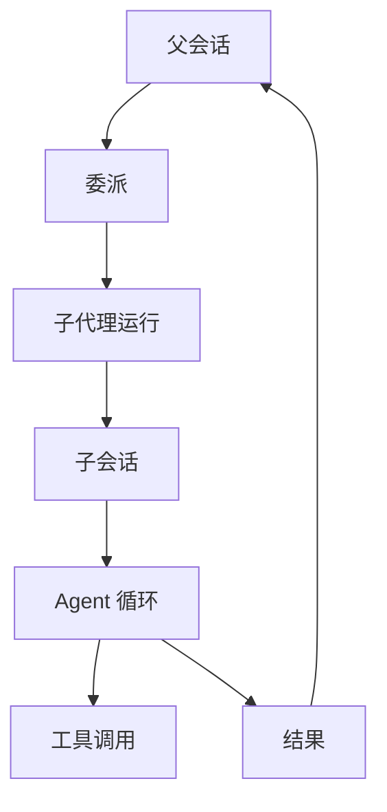

# 子代理系统

::: tip
子代理是「另一个上下文里的自己」：独立的会话、执行循环、工具集和模型配置，完成委派任务后只把最终结果带回父会话。深度排查往往要读几十个文件、跑多次命令、分析多份日志，这些过程如果都留在主会话里，等到要回复用户时上下文早已占满。子代理把「执行过程」与「最终结论」分开。
:::

## 运行模型

- **配置**：profile、执行后端、模型档位和工具集合。
- **会话**：独立的子会话，有自己的上下文和日志。
- **运行体**：默认内部后端中是一个完整的 Agent，外部后端中是一个独立的系统进程。
- **结果**：最终状态、文本或结构化输出，以及 Token 用量。

## Profile

Profile 是子代理的配置模板：

| 字段 | 作用 |
| --- | --- |
| `name` | 名字，用于委派时指定 |
| `description` | 让模型知道这个子代理适合什么 |
| `backend` | 执行后端，默认是内部 Agent |
| `engine` | 默认后端挂载的引擎，默认 `agent` |
| `tools` | 工具过滤 |
| `model` | 具体模型或模型档位 |
| `maxLevel` | 允许使用的最高档位 |
| `machine` | 执行机器 |
| `mode` | 权限模式 |
| `prompt` | 额外的系统提示 |
| `output` | 结构化输出结构 |
| `inherit` | 继承父会话上下文的方式 |
| `lifetime` | 一次性或可续 |

Profile 由扩展插件注册。系统提示词会列出当前可用的 profile，主模型据此选择委派对象。

::: tip
Profile 变化通过系统提示词和通知告知模型，而不改变工具定义，所以增减 profile 不会让前缀缓存失效。
:::

## 继承

| 方式 | 子代理看到 |
| --- | --- |
| `none` | 只有任务（默认行为） |
| `summary` | 父会话压缩后的摘要 + 任务 |
| `fork` | 父会话的对话记录 + 任务 |

`summary` 依赖会话压缩能力，不可用时降级为 `none` 并记录告警。`fork` 把父会话的历史作为引用材料放在最前面。

::: warning
无论哪种方式，子代理都看不到父会话的工具调用和工具结果。需要某条命令的输出时，把关键内容写进任务说明。
:::

## 生命周期

- **一次性**：运行完即结束。外部后端都是这种模式。
- **可续**：保留子会话，之后可以用运行 ID 唤醒继续对话。同一个父会话下，同名 profile 同时只能有一个实例在运行，需要并行就用不同的 profile。父会话关闭时释放关联的可续实例，执行数据和结果仍保留在轨迹中。

## 深度

子代理可以继续委派子代理。主会话深度为 `0`，每委派一次加一，达到上限后拒绝新的委派。默认上限 `4`，即最深到第 3 层。深度从最外层父会话全局累计。

## 模型与档位

可以指定档位（小、中、大）或具体模型。解析优先级：profile 指定的具体模型 → 调用时指定的档位 → profile 默认档位 → 路由默认档位 → 全局默认。实际档位还受 profile 的 `maxLevel` 和路由允许的最高档位限制。

::: tip
子代理的 Token 用量独立统计。默认档位是「中」，简单任务调低档位可以省钱。
:::

## 权限

子代理不继承父会话的提权，有自己的权限主体（通常是发起委派的用户），模式只会更严格。每次工具调用都重新校验规则、模式和等级。外部后端更敏感，启动默认需要最高权限等级，属于高危动作。

::: warning
不要指望用子代理绕过安全限制。
:::

## 执行环境

未指定 `machine` 时继承父代理的机器；指定时必须在当前用户可用的机器范围内，否则拒绝委派。外部后端的命令行也通过配置的机器执行，可以借此放进沙箱。

## 后台运行

耗时长的任务可以转后台：委派调用立即向父会话返回「已转后台」，任务进入后台列表并有独立日志，完成、失败或取消时通知父会话。父会话取消时，系统通知子代理收尾并释放资源。

## 轨迹

每次委派生成一条轨迹，包含 profile 名称与深度、子会话 ID、模型与工具调用明细、耗时与 Token 用量、最终结果或错误。

父会话的轨迹只显示委派的起点和汇总结果，细节在子代理自己的记录里。**父会话没拿到预期答案时，先看子代理的轨迹，判断是任务描述不清还是执行失败。**

## 外部后端

可以把任务交给独立的命令行工具执行：Claude CLI、Codex CLI、OpenCode、Pi。适配层负责拼接命令、注入模型、流式解析输出、提取工具调用与结果，并处理超时与取消。

- 都是一次性任务，不支持续聊。
- 能力完全由对应的命令行工具决定。
- 默认拒绝权限提示，适合无人值守。
- 单次任务有超时上限。

## 失败处理

子代理失败不会让父会话失败。委派工具把错误包装成失败的调用结果返回给模型，由模型决定重试、换 profile 还是告知用户。深度超限、后端不存在、机器不允许、模型解析失败都这样处理。

## 常见问题

**模型不派子代理**：确认委派工具可见、profile 列表非空、系统提示中有子代理说明。

**子代理什么都不知道**：默认 `inherit` 为 `none`，需要上下文就改为 `summary` 或 `fork`。

**续聊接不上**：只有可续运行支持续聊，且必须是同一个父会话、同一个 profile。

**结果很差**：多半是任务描述不完整。把目标、约束和必要信息写全，不要假设它能看到父会话的工具结果。

**外部后端超时**：先确认命令行工具能在终端正常运行，再检查登录状态、网络和超时配置。

## 下一步

- [Agent 与执行循环](./agents) — 子代理内部的循环。
- [权限与审批](./permissions) — 子代理的权限边界。
- [后台任务](./schedule-background) — 转后台后的生命周期。
- [子代理](/manual/usage/subagents) — 面向使用者的配置方式。
