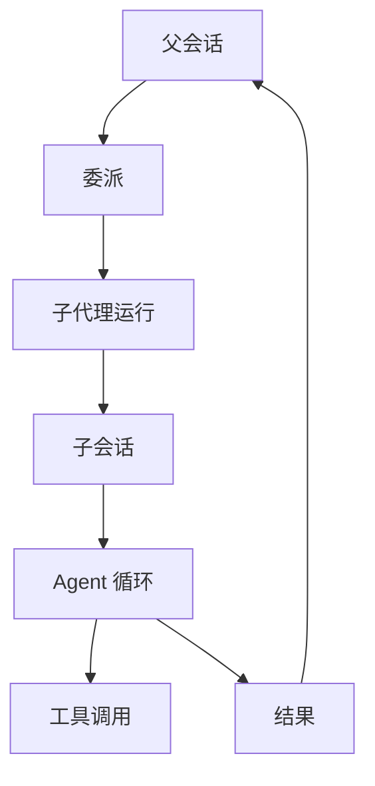

# 子代理

::: tip
子代理是「另一个上下文里的自己」。它有自己的会话、自己的循环、自己的工具和模型，干完只把结果带回来。
:::

主代理的上下文是稀缺资源。

一次排查要读二十个文件、跑五次命令、看三份日志。这些中间过程如果全留在主会话里，等到要回答用户时，窗口已经被占满了。

子代理解决的问题是：把「过程」和「结论」分开存放。

<!-- 架构页，可以使用代码与配置示意 -->

## 运行模型

一次子代理运行包含：

- **配置**：用哪个 profile、哪个引擎、哪个模型、什么工具集。
- **会话**：一个独立的子会话，带自己的日志。
- **运行体**：默认后端里是一个完整的 Agent；外部后端里是一个进程。
- **结果**：状态、文本或结构化数据、用量。

## Profile

Profile 是子代理的配置模板：

| 字段 | 作用 |
| --- | --- |
| `name` | 名字，用于委派时指定 |
| `description` | 让模型知道这个子代理适合什么 |
| `backend` | 执行后端，默认是内部 Agent |
| `engine` | 默认后端挂载的引擎，默认 `agent` |
| `tools` | 工具过滤 |
| `model` | 具体模型或模型档位 |
| `maxLevel` | 允许使用的最高档位 |
| `machine` | 执行机器 |
| `mode` | 权限模式 |
| `prompt` | 额外的系统提示 |
| `output` | 结构化输出结构 |
| `inherit` | 继承父会话上下文的方式 |
| `lifetime` | 一次性或可续 |

Profile 由插件注册。系统提示里会列出当前可用的 profile，模型据此决定派给谁。

::: tip
Profile 列表变化不会改变工具数组，而是通过系统提示与通知告诉模型。

这样增加一个 profile 不会让缓存前缀整体失效。
:::

## 继承

子代理默认什么都看不到，只有你给它的任务说明。

三种继承方式：

| 方式 | 子代理看到 |
| --- | --- |
| none | 只有任务 |
| summary | 父会话压缩后的摘要 + 任务 |
| fork | 父会话的对话记录 + 任务 |

摘要方式依赖压缩能力；压缩不可用时退回 none，并记录警告。

分叉方式会把父会话的对话作为一段引用材料放在最前面。

::: warning
三种方式都看不到父会话的工具调用与工具结果。

需要子代理知道某个命令输出，必须把关键内容写进任务说明。
:::

## 生命周期

### 一次性

跑完即结束。外部后端全部是这种。

### 可续

子会话被保留，可以用运行 id 接着聊。

同一个父会话下，同名 profile 同时只能有一个实例在跑。想并行，用不同的 profile。

可续运行在父会话关闭时被释放；结果会保留在轨迹里。

## 深度

委派可以嵌套：子代理还能再派子代理。

系统用深度限制防止无限套娃：

- 主会话深度为 0。
- 每委派一次，深度加一。
- 达到上限时，新的委派被拒绝。

默认上限是 4，意味着最深处是第 3 层子代理。

深度是按「从最外层算起」累计的，不是按当前会话单独计算。

## 模型与档位

子代理有自己的模型选择：

- **档位**：小、中、大。
- **具体模型**：直接指定某个模型地址。

解析顺序大致是：profile 指定的模型 → 调用时指定的档位 → profile 的档位 → 路由的默认档位 → 全局默认。

档位还受两层上限约束：profile 自己的最高档位，以及路由配置的最高档位。

::: tip
子代理是独立会话，用量独立统计。

默认档位是「中」；如果小模型够用，把默认档位调低能省下不少钱。
:::

## 权限

子代理不继承父会话的权限提升。

它有自己的权限主体（通常是发起委派的人），并且模式只会更严格，不会更宽松。

外部后端更敏感：启动它们默认需要最高等级，属于危险动作。

::: warning
不要指望通过子代理绕过限制。

权限判定会对子代理的每次工具调用重新执行，规则、模式、等级一样生效。
:::

## 执行环境

子代理可以指定机器。

不指定时，默认继承父代理的机器；指定时，必须在该用户可用的机器范围内，否则直接拒绝。

外部后端的命令行也通过机器执行，所以可以把它们关进沙箱。

## 后台运行

长任务可以转到后台：

- 委派立刻返回一个「已转后台」的结果。
- 任务进入后台任务列表，带自己的输出日志。
- 完成、失败或取消时通知父会话。

取消会通知子代理收尾，并让它释放持有的资源。

## 轨迹

每次委派都会生成一条轨迹记录，包含：

- profile 名与深度。
- 子会话 id。
- 模型与工具调用。
- 耗时与用量。
- 最终结果或错误。

父会话的轨迹里只显示委派的起点与结果；细节在子代理自己的记录里。

这条分界很重要：**父会话看不到答案时，先去看子代理的轨迹，判断是任务描述不清还是执行失败**。

## 外部后端

外部后端把任务交给命令行工具：

- Claude CLI
- Codex CLI
- OpenCode
- Pi

适配层负责：拼接命令、注入模型、解析流式输出、提取工具调用与最终结果、处理超时与取消。

它们的限制：

- 一次性，不可续。
- 执行能力由那个工具自己决定。
- 默认拒绝权限提示，适合无人值守。
- 单次任务有超时上限。

## 失败处理

子代理失败不会让父会话失败。

委派工具会把错误包装成一个失败的调用结果返回给模型，模型可以决定重试、换个 profile，或者直接告诉用户。

深度超限、后端不存在、机器不允许、模型解析失败，都会以这种形式出现。

## 排查

**模型不派子代理。**

确认委派工具可见、profile 列表非空、系统提示里有可用的子代理说明。

**子代理什么都不知道。**

检查继承方式。默认是不继承，只有任务说明。需要上下文就改成摘要或分叉。

**接着聊接不上。**

只有可续运行能用 id 续，而且必须是同一个父会话、同一个 profile。

**子代理的结果很差。**

多数是任务描述的问题。把目标、约束、需要的信息都写进任务，不要假设它能看见父会话的工具结果。

**外部后端超时。**

先确认命令行工具能在终端里跑通，再检查登录状态、网络与超时设置。

## 下一步

- [Agent 与执行循环](./agents) — 子代理内部的循环。
- [权限与审批](./permissions) — 子代理的权限边界。
- [后台任务](./schedule-background) — 转后台后的生命周期。
- [子代理](/manual/usage/subagents) — 面向使用者的配置方式。
