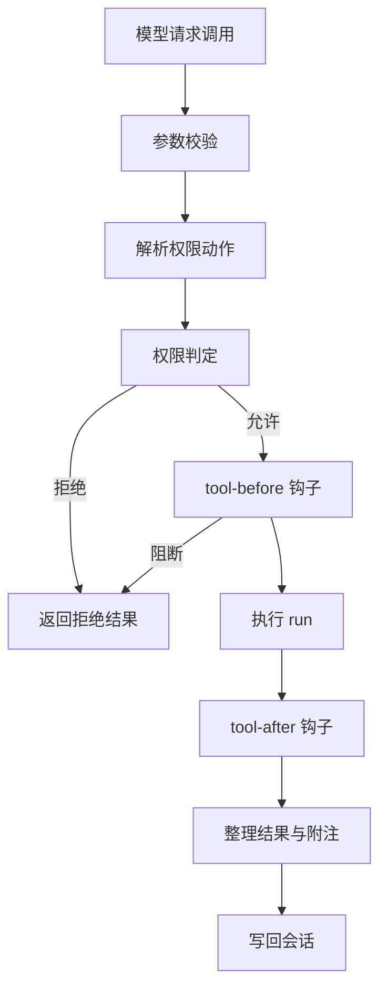

# 工具系统

::: tip
模型只能生成文本，不能读文件、跑命令或查数据库。工具系统把「有哪些动作、各接收什么参数」转换成模型能理解的格式，解析并执行模型的调用请求，再把结果写回。本页介绍工具如何定义、筛选、授权和执行，以及工具很多时如何只把必要的部分交给模型。
:::

<!-- 架构页，可以使用代码与配置示意 -->

## 定义

```ts
ctx.tools.define({
  name: 'fs_read',
  description: '读取文本文件内容。',
  args: Schema.object({
    path: Schema.string().required().description('目标路径'),
  }),
  traits: { effect: 'read' },
  permission: (args) => ({ name: 'fs:read', target: { path: args.path } }),
  async run({ path }, call) {
    const machine = await ctx.computer.of(call.agent)
    return { content: [{ type: 'text', text: String(await machine.read(path)) }] }
  },
  render: {
    result: (_args, value) => ({ kind: 'read', title: '读取文件' }),
  },
})
```

| 字段 | 作用 |
| --- | --- |
| `name` | 模型看到的名字，必须唯一 |
| `description` | 模型判断「何时调用」的依据 |
| `args` | 参数结构，使用 Schema 声明 |
| `result` | 可选的结果结构，用于校验返回结果 |
| `traits` | 并发、副作用、超时、延迟加载等行为特征 |
| `permission` | 该调用对应的权限动作 |
| `forward` | 转发为另一个工具调用 |
| `run` | 工具的实际执行逻辑 |
| `render` | 在界面上的呈现方式 |
| `describe` | 根据调用者动态生成描述文本 |

`description` 是模型选择工具的主要依据，写清具体场景比简短笼统的描述更有效。

**traits**：

- `parallel`：是否允许与其他工具并行。
- `effect`：`read`、`write` 或 `exec`，参与权限判定。
- `timeout`：同步等待上限，默认 180 秒（加载后台能力时）。
- `background`：超时后是否转后台；`false` 则直接超时中止。
- `deferred`：是否默认延迟加载。

::: warning
`effect` 不是装饰。没有匹配到显式权限规则时，权限系统用它快速预检：读取可以直接放行，写入结合运行模式判断，执行受最严格的限制。写错 `effect` 等于开错了安全检查的门。
:::

**permission** 可以是固定动作名，也可以按参数动态计算：

```ts
permission: (args) => ({
  name: args.command.startsWith('git ') ? 'exec:git' : 'exec',
  target: { cwd: args.cwd ?? '.' },
  risk: 'dangerous',
})
```

计算出的动作决定审批弹窗展示的内容、所需权限等级，以及能否被规则持久记住。

## 调用管线



- **参数校验**：按 `args` 校验实参。失败时返回结构化错误给模型，而不是抛出异常，让模型在下一步自我修正。
- **权限判定**：工具不自己判断能否执行，而是把动作名、目标和风险交给权限服务。插件、技能和 MCP 的工具走同一套判定。
- **钩子**：`chatluna/tool-before` 在执行前触发，可改写参数或返回阻断原因；`chatluna/tool-after` 在执行后触发，可补充上下文、脱敏或追加提示。钩子产生的附注随结果一起写回。
- **结果**：统一整理为结构化记录，包含状态、内容块、元信息和附加消息。运行失败返回 `ok: false`，不会让对话崩溃；只有致命系统错误才向上抛出。

## 三种工具模式

工具多时，把所有参数结构塞进提示词会耗费大量上下文：

| 模式 | 模型看到的内容 |
| --- | --- |
| `native` | 完整的工具清单 |
| `search` | 常驻工具 + 搜索工具，其余工具按需加载 |
| `code` | 代码执行环境 + 常驻工具，其余工具通过代码调用 |

- **native**：一次看到全部声明，链路最短，适合工具较少的场景。
- **search**：提示词只列工具名和一句话说明，模型先调用搜索工具，命中的工具再加载完整结构。
- **code**：给模型一个代码执行环境，把工具封装成 API，一段代码就能调度多个工具，适合批量处理、循环和数据清洗。常驻工具和 `run_code` 仍直接展示。

搜索的默认配置：

| 配置项 | 默认值 |
| --- | --- |
| 模式 | 自动 |
| 自动启用阈值 | 20 个工具 |
| 按需加载清单 | `mcp__*` |
| 单次返回数量 | 5 个 |

自动模式下，工具总数超过阈值才启用搜索，否则展示完整清单。

::: tip
工具少时开启搜索，模型每次用工具都要多一轮才能拿到参数结构，反而更慢。
:::

代码模式会根据当前 Agent 可见的工具动态生成一份接口说明，所以不同会话看到的接口可能不同，工具增减也会改变系统提示词。

## 可见性

工具能否出现在模型面前，要依次经过：

1. 插件注册时的初始过滤。
2. 引擎声明的可用工具集。
3. 场景规则中的允许或禁用列表。
4. 工具策略中的全局禁用开关。
5. 技能或 MCP 服务自身的启闭状态。

每一层只能在上一层基础上收窄，不能重新启用已被排除的工具。

::: warning
所以会出现「管理界面能看到工具，模型却说没有」：界面展示的是工具存在，模型看到的是经过所有筛选后剩下的子集。
:::

## 策略与权限

工具策略分三档：**自动**（安全时直接执行）、**需要审批**、**禁用**（对模型隐藏）。支持通配符批量配置，例如把某个前缀下的危险工具都设为需要审批。

策略只是默认倾向，最终由权限服务综合以下因素裁定：

1. 工具声明的权限动作与风险标记。
2. 当前用户的权限等级与权限模式。
3. 匹配到的权限规则。
4. 操作是否属于必须人工确认的高风险。

即使用户权限等级很高，高危动作依然会触发人工确认。

## 超时与后台

`timeout` 是同步等待上限，不是后台任务的总时长。超时后，允许转后台的调用交给后台任务继续，先返回占位结果，完成后通过通知写回原会话；不允许的直接按失败处理。

::: tip
模型必须立刻拿到结果才能继续的，不要转后台；可以延后接收的耗时任务，交给后台。
:::

## 常见问题

**模型说工具不存在**：按可见性链路逐层检查：插件是否注册、引擎是否过滤、场景规则是否禁用、全局策略是否关闭、MCP 服务是否在线。

**调用被拒绝**：先看拒绝原因，通常是受限的权限模式、命中拒绝规则、权限等级不足，或用户取消了审批。

**结果太长撑爆上下文**：检查工具是否支持输出转存。文件读取和命令执行工具超出阈值时会写入文件，只返回开头摘要和路径。

**总是超时**：先区分是耗时长还是卡死。耗时长就调大 `timeout`，或允许转后台。

**工具名冲突**：同名工具按注册顺序和来源优先级覆盖或跳过。插件工具统一加前缀。

## 下一步

- [权限与安全](./permissions) — 判定与审批的完整规则。
- [技能](./skills) — 工具之上的方法层。
- [MCP](./mcp) — 外部工具如何投影进来。
- [后台任务](./schedule-background) — 超时后的去处。
