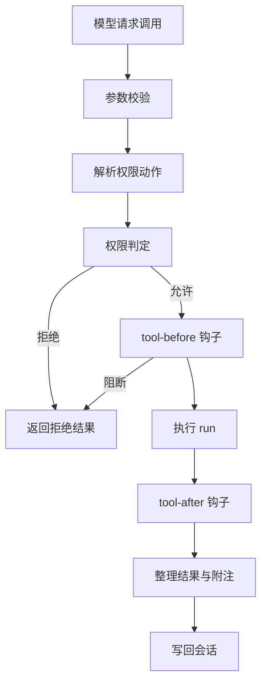

# 工具系统

::: tip
工具是大语言模型与外部现实交互的唯一通道。本节将介绍工具在 ChatLuna 中是如何定义、筛选、授权与执行的，以及当系统注册了海量工具时，如何只把必要的那部分上下文交给模型。
:::

模型本身只能理解和生成文本。

它既不能直接读取磁盘上的文件，也无法在宿主环境中运行命令或查询数据库。系统赋予模型这些能力的方式，是在中间层把「当前有哪些动作、每个动作接收什么参数、执行后产生什么结果」转换成模型可理解的格式，再把模型的调用请求解析执行，并将结果写回模型。

这一层连接模型与外部世界的桥梁，就是工具系统。

<!-- 架构页，可以使用代码与配置示意 -->

## 工具的定义

注册一个工具时，最核心的三要素是唯一标识、参数结构与执行逻辑：

```ts
ctx.tools.define({
  name: 'fs_read',
  description: '读取文本文件内容。',
  args: Schema.object({
    path: Schema.string().required().description('目标路径'),
  }),
  traits: { effect: 'read' },
  permission: (args) => ({ name: 'fs:read', target: { path: args.path } }),
  async run({ path }, call) {
    const machine = await ctx.computer.of(call.agent)
    return { content: [{ type: 'text', text: String(await machine.read(path)) }] }
  },
  render: {
    result: (_args, value) => ({ kind: 'read', title: '读取文件' }),
  },
})
```

### 关键字段

| 字段 | 作用 |
| --- | --- |
| `name` | 模型看到的名字，必须唯一 |
| `description` | 模型判断「何时调用」的依据 |
| `args` | 参数结构，使用 Schema 声明 |
| `result` | 可选的结果结构，用于校验返回结果 |
| `traits` | 并发、副作用、超时、延迟加载等行为特征 |
| `permission` | 该调用对应的权限动作 |
| `forward` | 转发为另一个工具调用 |
| `run` | 工具的实际执行逻辑 |
| `render` | 在界面上的呈现方式 |
| `describe` | 根据调用者动态生成描述文本 |

在定义工具时，`description` 是模型评估是否选用该工具的主要依据。清晰且具体的场景说明，远比宽泛简短的描述更有利于模型做出准确决策。

### traits

- **parallel**：是否允许与其他工具并行执行。
- **effect**：可选 `read`、`write`、`exec`，直接参与权限判定。
- **timeout**：同步等待上限，默认 180 秒（加载后台能力时）。
- **background**：超过超时上限时是否转入后台；设为 `false` 则直接超时中止。
- **deferred**：是否默认按需延迟加载。

::: warning
`effect` 不是装饰属性。

权限系统在没有匹配到显式规则时，会借助 `effect` 进行快速预检：读取类可以直接放行，写入类需结合运行模式判断，执行类通常受到最严苛的限制。写错 `effect` 等于给工具的安全检查开错了门。
:::

### permission

`permission` 可以声明为固定的动作名，也可以传入函数根据运行时参数动态计算：

```ts
permission: (args) => ({
  name: args.command.startsWith('git ') ? 'exec:git' : 'exec',
  target: { cwd: args.cwd ?? '.' },
  risk: 'dangerous',
})
```

计算得出的动作决定了审批弹窗中向用户呈现的内容、执行该操作所需的权限等级，以及该操作能否被安全规则持久化记录。

## 调用管线

一次完整的工具调用在内部会经历以下阶段：



### 参数校验

系统首先依据工具声明的 `args` 结构校验模型传入的实参。

参数校验失败时不会向外抛出未捕获异常，而是将其转换为结构化的错误结果返回给模型。这样可以让模型感知到传参错误并在后续步骤中自我修正，这也是 Agent 执行循环能够自我愈合的前提。

### 权限判定

工具本身不负责裁定「当前操作能否执行」，而是将动作名、目标资源与风险等级交由权限服务统一裁决。

无论工具来自插件、预设技能还是 MCP 服务，在执行前都会走同一套安全判定逻辑。

### 钩子

在工具实际执行的前后，系统各提供了一个生命周期钩子：

- `chatluna/tool-before`：在工具执行前触发，可用于改写参数，或返回阻断原因直接终止执行。
- `chatluna/tool-after`：在工具执行后触发，可用于补充上下文、对敏感信息进行脱敏或追加提示。

钩子执行过程中产生的附注信息，会作为额外的文本与工具执行结果一并写回上下文并返回给模型。

### 结果

工具执行的结果会被统一整理为结构化记录，包含执行状态、内容块、元信息以及附加消息。

即使工具在运行过程中失败，系统也会返回包含 `ok: false` 的错误结果，避免整个对话崩溃。只有底层的致命系统错误才会向上抛出。

## 三种工具模式

当注册的工具较多时，如果把所有工具的参数结构全部填入提示词，会消耗大量的上下文空间。

为此，系统提供了三种不同的工具呈现模式以适应不同场景：

| 模式 | 模型看到的内容 |
| --- | --- |
| `native` | 完整的工具清单 |
| `search` | 常驻工具 + 搜索工具，其余工具按需加载 |
| `code` | 代码执行环境 + 常驻工具，其余工具通过代码调用 |

### native

这是最直接的模式，适合工具总数较少的中小型场景。

在该模式下，模型一次性即可看到所有工具的完整声明，无需额外的搜索与发现步骤，交互链路最短，响应最迅速。

### search

在搜索模式下，只有常驻工具会保留完整定义，其余工具均转为按需延迟加载：

1. 提示词中仅提供工具名与一句话说明。
2. 模型根据需求调用搜索工具查询相关能力。
3. 系统完整加载命中工具的结构，模型再发起正式调用。

搜索能力的默认配置如下：

| 配置项 | 默认值 |
| --- | --- |
| 模式 | 自动 |
| 自动启用阈值 | 20 个工具 |
| 按需加载清单 | `mcp__*` |
| 单次返回数量 | 5 个 |

在自动模式下，系统仅在可用工具总数超过设定阈值时才真正启用搜索；未达到阈值时会自动回退为展示完整清单。

::: tip
阈值并非越大越好。在可用工具较少时开启搜索，模型每次使用工具都要多花费一轮对话才能获取参数结构，反而会拖慢整体响应速度。
:::

### code

代码模式会为模型分配一个代码执行环境，把可用工具封装为可在代码中调用的 API 接口。

这种模式适合需要批量处理、复杂循环或数据清洗的重型任务：模型只需编写一段代码即可一次性调度多个工具，执行效率远高于单步交互调用。

在代码模式下，常驻工具与 `run_code` 仍然会直接展示给模型。

## 可见性

一个工具最终能否出现在模型的视野中，需要经过多层管线的连续筛选：

1. 插件注册时的初始过滤。
2. 引擎声明的可用工具集。
3. 场景规则中的允许或禁用列表。
4. 工具策略中的全局禁用开关。
5. 技能或 MCP 服务自身的启闭状态。

每一层过滤都只能在上一层的基础上进一步收窄可见范围，无法重新启用上层已经被排除的工具。

::: warning
这也解释了开发者常遇到的现象：「为什么在管理界面中能看到工具，但模型却坚称它不存在」。

管理界面展示的是工具在系统中的「存在性」，而模型看到的则是「经过所有层级筛选后依然保留」的有效子集。两者并不等同。
:::

## 策略

工具策略在系统层面划分为三档：

- **自动**：符合安全条件时直接执行。
- **需要审批**：在执行前必须先询问并获得用户许可。
- **禁用**：彻底对模型隐藏，不可调用。

工具策略支持通过通配符进行批量配置，例如可以将某个指定前缀下的所有危险工具统一配置为需要审批。

在这三档策略之上，还存在细粒度的权限模式与权限规则。策略代表的是「该工具的默认倾向」，而权限服务才是裁定「当前特定调用是否允许执行」的最终裁判。

## 工具与权限的配合

一次具体的工具调用最终是否得以执行，取决于以下要素的综合裁定：

1. 工具声明的权限动作与风险标记。
2. 当前用户的权限等级与生效的权限模式。
3. 匹配到的权限规则列表。
4. 操作是否被判定为必须人工确认的高风险等级。

工具策略中配置的「需要审批」只是一项预设倾向，最终决定权始终在权限服务手中。

反之，即使用户在系统中拥有极高的权限等级，一旦调用的动作被标定为高危风险，系统依然会严格触发人工确认流程。

## 超时与后台

工具定义中声明的 `timeout` 代表「同步等待上限」，而不是「后台任务的整体执行时长」。

当一次调用的同步等待时间超过该上限时：

- 如果该工具允许转入后台，调用会移交后台任务继续执行，并先行向模型返回一个占位结果。
- 如果该工具不允许转入后台，调用流程将直接超时并按失败处理。

转入后台的任务在运行完毕后，最终产生的结果会通过系统通知写回原始会话中。

::: tip
判断是否开启后台的依据很简单：该结果模型是否「必须立刻拿到才能继续」。若是，就不要转入后台；若属于可延后接收的耗时任务，交由后台执行即可。
:::

## 代码模式下的 SDK

在代码模式中，系统会根据当前可见的工具集动态生成一份调用说明，供模型在编写代码时参考。

这份接口说明完全是根据「当前 Agent 能够看到的内容」动态构建的。因此在不同的会话或角色配置下，模型看到的可用代码接口可能完全不同。

这也是可用工具发生变动时会直接影响系统提示词的原因——工具的增减改变了代码模式所需的接口说明文本。

## 排查

在开发和使用工具遇到异常时，可以参考以下常见场景进行排查：

**模型提示工具不存在**  
请按可见性链路自上而下逐层核对：检查插件是否成功注册、引擎是否过滤了该工具、场景规则是否将其禁用、全局策略是否关闭，以及对应的 MCP 服务是否处于在线连接状态。

**工具调用被拒绝**  
建议先查看具体的拒绝原因。通常是因为当前处于受限的权限模式、命中了显式的拒绝规则、调用者的权限等级不足，或是用户在审批时取消了授权。

**工具结果过长撑爆上下文**  
核查工具是否支持输出转存。常见的文件读取与命令执行工具在输出内容超出安全阈值时，通常会自动写入文件，仅向上下文返回开头摘要与文件路径。

**工具总是超时**  
首先确认是由于耗时较长引发的同步超时，还是底层进程出现了死锁卡死。若属于同步超时，可以适当调大 `timeout` 阈值，或将工具配置为允许转入后台运行。

**工具名字冲突**  
当不同来源注册了同名工具时，系统会根据注册顺序与来源优先级进行覆盖或跳过。为了避免命名冲突，建议在插件中定义工具时统一附带专属前缀。

## 下一步

- [权限与安全](./permissions) — 判定与审批的完整规则。
- [技能](./skills) — 工具之上的方法层。
- [MCP](./mcp) — 外部工具如何投影进来。
- [后台任务](./schedule-background) — 超时后的去处。
