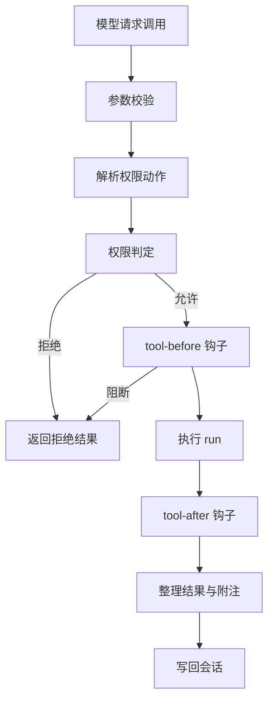

# 工具系统

::: tip
工具是模型与外部世界之间的唯一通道。这一页讲工具是怎么被定义、被筛选、被授权、被执行，以及工具很多时如何只把必要的那部分交给模型。
:::

模型本身只能生成文本。

它能读文件、能跑命令、能查数据库，全靠系统把「这些动作是什么、参数是什么、结果是什么」翻译成它看得懂的格式，再把它的请求翻译回来执行。

这一层就是工具系统。

<!-- 架构页，可以使用代码与配置示意 -->

## 工具的定义

一个工具至少要有名字、参数结构和执行函数：

```ts
ctx.tools.define({
  name: 'fs_read',
  description: '读取文本文件内容。',
  args: Schema.object({
    path: Schema.string().required().description('目标路径'),
  }),
  traits: { effect: 'read' },
  permission: (args) => ({ name: 'fs:read', target: { path: args.path } }),
  async run({ path }, call) {
    const machine = await ctx.computer.of(call.agent)
    return { content: [{ type: 'text', text: String(await machine.read(path)) }] }
  },
  render: {
    result: (_args, value) => ({ kind: 'read', title: '读取文件' }),
  },
})
```

### 关键字段

| 字段 | 作用 |
| --- | --- |
| `name` | 模型看到的名字，必须唯一 |
| `description` | 模型判断「什么时候用」的依据 |
| `args` | 参数结构，用 Schema 声明 |
| `result` | 可选的结果结构，用于校验 |
| `traits` | 并发、副作用、超时、延迟加载 |
| `permission` | 这次调用属于哪个权限动作 |
| `forward` | 转发成另一个工具调用 |
| `run` | 实际执行 |
| `render` | 在界面上的呈现方式 |
| `describe` | 按调用者动态生成描述 |

`description` 是模型选择工具的主要依据，写得具体比写得短更重要。

### traits

- **parallel**：是否允许与其他工具并行执行。
- **effect**：`read`、`write`、`exec`，直接参与权限判定。
- **timeout**：同步等待上限，默认 180 秒（加载了后台能力时）。
- **background**：超过上限时是否转入后台；设为 false 则直接超时中止。
- **deferred**：是否默认按需加载。

::: warning
`effect` 不是装饰。

权限系统会用它在没有规则时做快速判断：读取类可以直接放行，写入类要看模式，执行类通常更严格。写错 effect 等于给工具开错门。
:::

### permission

`permission` 可以是固定的动作名，也可以根据参数动态计算：

```ts
permission: (args) => ({
  name: args.command.startsWith('git ') ? 'exec:git' : 'exec',
  target: { cwd: args.cwd ?? '.' },
  risk: 'dangerous',
})
```

这决定了审批时展示什么、需要什么等级、能不能被规则记住。

## 调用管线

一次工具调用大致经过这些阶段：



### 参数校验

按 `args` 结构校验模型给的参数。

校验失败不会抛异常到外面，而是返回一个结构化的错误结果，让模型自己修正——这是 Agent 循环能自我纠错的前提。

### 权限判定

工具不自己判断「能不能用」，而是把动作名、目标、风险交给权限服务。

这保证了不管工具来自插件、技能还是 MCP，走的都是同一套规则。

### 钩子

执行前后各有一个事件：

- `chatluna/tool-before`：可以改写参数，或者返回一个阻断原因。
- `chatluna/tool-after`：可以补充上下文、脱敏、追加提示。

钩子产生的附注会作为额外的文本一起返回给模型。

### 结果

工具结果统一成结构化记录：是否成功、内容块、元信息、附加消息。

失败的调用也返回结果（`ok: false`），而不是让整个回合崩溃。只有真正的系统错误才会向上抛。

## 三种工具模式

工具太多时，把所有工具的参数结构都塞进提示词会占用大量上下文。

系统提供三种呈现方式：

| 模式 | 模型看到什么 |
| --- | --- |
| `native` | 完整的工具清单 |
| `search` | 常驻工具 + 搜索工具，其余按需加载 |
| `code` | 代码执行环境 + 常驻工具，其余通过代码调用 |

### native

最直接。适合工具数量不多的场景。

模型一次就能看到所有工具，不用额外的搜索步骤，响应最快。

### search

只有常驻工具保留完整定义，其余工具变成「按需」：

1. 提示词里给出工具名与一句话说明。
2. 模型调用搜索工具查询。
3. 命中的工具被完整加载，模型再正式调用。

搜索的默认配置：

| 项目 | 默认 |
| --- | --- |
| 模式 | 自动 |
| 自动启用阈值 | 20 个工具 |
| 默认按需 | MCP 工具 |
| 单次返回 | 5 个 |
| 单次上限 | 20 个 |

自动模式下，只有当工具数量超过阈值时才真正启用搜索；不到阈值时退回完整清单。

::: tip
阈值不是越大越好。工具少的时候开启搜索，模型要多花一轮才能拿到参数，反而更慢。
:::

### code

给模型一个代码执行环境，把工具包装成可以从代码里调用的接口。

适合需要批量处理、循环、数据清洗的任务：模型写一段代码，一次调用多个工具，比逐步调用快得多。

代码模式下，常驻工具与 `run_code` 仍然直接可见。

## 可见性

一个工具最终能不能被模型看到，要经过多层筛选：

1. 插件注册时的过滤。
2. 引擎声明的工具集。
3. 场景规则里的允许/禁用列表。
4. 工具策略里的全局禁用。
5. 技能或 MCP 服务自身的开关。

每层都只能进一步收窄，不能把上层已经排除的工具加回来。

::: warning
这解释了「为什么我在工具页看到它，但模型说没有」。

工具页展示的是「存在」，模型看到的是「经过所有筛选之后仍可见」。两者不是一回事。
:::

## 策略

工具策略只有三档：

- **自动**：直接执行。
- **需要审批**：执行前询问。
- **禁用**：对模型隐藏。

策略支持通配符批量配置，例如把某个前缀下的所有工具统一设为需要审批。

三档之上还有权限模式与权限规则。策略是「这个工具的默认态度」，权限是「这次调用到底行不行」。

## 工具与权限的配合

一次调用最终是否执行，取决于：

1. 工具声明的权限动作。
2. 当前用户等级与权限模式。
3. 匹配到的权限规则。
4. 是否为需要人工确认的风险等级。

工具策略里的「需要审批」只是一个提示，真正的决定由权限服务做出。

反过来，即使用户等级很高，标记为高危的动作仍然需要人工确认。

## 超时与后台

工具声明的 `timeout` 是「同步等待上限」，不是「任务总时长」。

超过上限时：

- 如果允许转后台，调用会交给后台任务继续跑，先给模型一个占位结果。
- 如果不允许，调用直接超时失败。

后台任务完成后，结果会通过通知回到会话。

::: tip
判断标准很简单：这个结果是不是「现在就要」。

是，就别转后台；不是，就让它慢慢跑。
:::

## 代码模式下的 SDK

代码模式会把当前可见的工具生成一份调用说明，模型写代码时照着调用。

这份说明是按「当前这个 Agent 能看到什么」动态生成的，所以不同会话里生成的代码可能不一样。

这也是为什么工具变动会改变提示词——它改变了代码模式的说明文本。

## 排查

**模型说没有某个工具。**

按可见性链路逐层检查：插件是否注册、引擎是否过滤、场景规则是否禁用、策略是否关闭、MCP 服务是否在线。

**工具调用被拒绝了。**

看拒绝原因。可能是权限模式、规则命中、等级不足，或者用户拒绝了审批。

**工具结果太长撑爆上下文。**

检查是否支持输出转存；很多文件与命令工具在超过阈值时会写文件，只返回开头。

**工具总是超时。**

先确认是同步超时还是真的卡住。同步超时可以把 `timeout` 调大，或者允许转后台。

**工具名字冲突。**

同名工具会覆盖或跳过，取决于注册顺序与来源。给插件工具加前缀是最稳妥的做法。

## 下一步

- [权限与安全](./permissions) — 判定与审批的完整规则。
- [技能](./skills) — 工具之上的方法层。
- [MCP](./mcp) — 外部工具如何投影进来。
- [后台任务](./schedule-background) — 超时后的去处。
