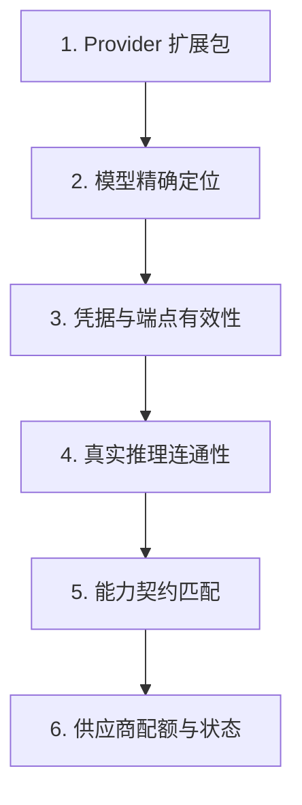

# 排错与诊断

先确定失败在哪个边界，再改动单项配置。一次成功的 HTTP 请求、保存提示、模型列表或流式文字，都不能代替整个对话链路的完成证据。本页按故障现象组织排查步骤，不要求你预先删除数据库、重装全部依赖包或放开所有系统权限。

## 收集最小诊断证据

在改动任何配置前，先收集并记录以下核心信息：

- 故障发生时间与复现步骤
- ChatLuna 详细运行版本与部署方式
- 当前实例名称或实例目录
- 出错页面、宿主平台与会话 ID (Session ID)
- 完整错误码与最近一次配置改动
- 服务端日志与浏览器控制台 (Console) 报错输出

::: danger 严禁泄露敏感凭据
向社区或第三方提供日志和排错资料前，必须彻底移除 `Authorization` 请求头、访问口令、API Key、平台身份凭证、用户聊天消息和工具执行输出。切勿直接导出并分享整个运行环境或私人 `chatluna.yml`。
:::

在已有实例目录中运行静态诊断命令：

```sh
# 列出当前管理的所有实例
chatluna list

# 静态检查当前目录下的配置文件
chatluna doctor config --dir .
```

::: tip
在源码工作区中，可通过 `yarn chatluna` 运行等价入口。`doctor config` 仅执行本地配置的静态检查，不会替你测试全部远端模型。
:::

## 启动失败或配置未生效

当实例无法启动或加载了非预期的配置时，按以下步骤排查：

### 1. 确认启动目标与根清单优先级

`--dir` 选项具有最高优先级。若你在命令行中显式传入实例名，系统将选用受管目录，不会跟随当前工作目录。

ChatLuna 查找根清单的优先顺序如下：

1. `cordis.yml`
2. `cordis.yaml`
3. `chatluna.yml`
4. `chatluna.yaml`

检查清单文件中的 `include` 引用关系，确认你正在编辑的文件确实属于生效链路。

### 2. 验证清单语法与服务依赖

- 逐项检查 YAML 缩进语法。
- 确认每个条目配置了稳定的 `id`。
- 确认相关插件包已在环境中正确安装，未标记 `disabled: true`。
- 确认当前插件声明必需的 `inject` 服务依赖已被满足且已成功加载。

### 3. 检查构建产物与开发模式行为

在新增插件包或修改依赖后，必须先在终端执行构建：

```sh
yarn build
```

运行时若抛出 `ERR_MODULE_NOT_FOUND`，通常是因为对应插件包的 `lib` 编译产物尚未生成，而非 TypeScript 声明路径有误。

开发命令 `chatluna dev .` 会读取当前根清单，用 tsx 直接加载源码并开启热重载；它**不会**启用生产 Supervisor 的恢复机制与安全模式。启动恢复报告与常规业务异常应分别查看。

::: warning 使用修复命令前请先备份
运行 `chatluna repair` 可能会修改工程文件。执行前必须先阅读现有的启动诊断报告并备份数据。`chatluna report` 仅用于查看本地已有的报告与 Issue 草稿，不会自动将资料发送到社区。
:::

若热重载 (HMR) 后出现重复事件监听或工具重名异常，检查资源是否正确绑定到了当前插件的生命周期，不得使用全局 `Set` 等方式掩盖生命周期泄漏。

## Web 界面打不开、持续加载或离线

对照下表，根据具体现象优先排查对应层级：

| 现象 | 优先排查项 |
| --- | --- |
| TCP 连接拒绝 (Connection Refused) | 进程存活状态、实际监听地址与端口占用、Docker Compose 服务运行状态 |
| HTTP 401 Unauthorized | 登录会话过期、访问口令变更、反向代理是否丢弃了认证请求头 |
| HTTP 403 Forbidden | `allowRemote` 来源访问限制、操作权限等级，勿直接判定为密码错误 |
| HTTP 404 Not Found | 访问路径、插件挂载路由、前端静态资源构建产物、反向代理路径前缀重写 |
| 首屏展示旧数据但无法进行任何交互 | WebSocket 连接是否已断开，页面当前可能仅展示断线前的本地快照 |
| 仅特定子页面报错打不开 | 对应页面功能包、前端入口编译产物、所依赖的基础服务与 action/state 状态 |

在受信任的本机环境中测试基础健康检查端点：

```sh
# 5028 为默认示例端口，请替换为实际监听端口
curl --fail http://127.0.0.1:5028/api/health
```

::: tip 端点状态局限性
`/api/health` 仅证明当前 HTTP 服务进程处于正常响应状态。它不代表远端模型服务、聊天平台 Adapter、数据持久化插件和 WebSocket 通道全部处于健康状态。
:::

配置反向代理与网络访问时，注意以下网络边界：

1. **协议通道隔离**：管理界面的 state/action、对话持久化 Durable SSE 与实时 Live SSE 属于独立的协议通道，故障排查时不能仅尝试重连其中一条。
2. **反向代理配置**：反向代理必须正确转发 WebSocket 握手，并禁用对流式响应接口的缓冲 (Buffering)。
3. **Docker 端口映射**：Docker 镜像内部允许容器间网络互通，但官方 Compose 配置在宿主机上默认仅将端口映射到回环地址 (`127.0.0.1`)。若需配置远程访问，请检查宿主机的公网发布地址、HTTP 监听配置、来源 IP 限制以及 TLS/HTTPS 终止，严禁以直接关闭认证来解决连通性问题。

## 忘记管理访问口令

先确定当前口令的生效来源：`server` 清单配置、`CHATLUNA_TOKEN` 环境变量或文件模式 (File Mode)。

- **固定口令**：若通过配置文件或 `CHATLUNA_TOKEN` 固定了口令，必须在原配置来源中修改。删除 `auth.json` 无法覆盖依然存在的静态配置。
- **文件模式**：在文件模式下，`auth.json` 仅保存单向哈希值与签名密钥，无法反向解密出明文。若需重置，请先停止实例并备份数据，由管理员删除 `auth.json` 并重启实例，从标准输出 (stdout) 日志中获取新生成的随机口令。此操作会使原有的已签名会话全部失效。
- **弱口令回退**：若传入的固定口令未达到强度要求，系统将忽略该输入并自动回退到文件模式。此时请直接查看启动日志，而不是反复尝试同一个弱口令。

::: danger 禁止破坏性操作
严禁直接删除整个数据目录来重置密码，切勿在公开网络渠道中分享首次登录链接。
:::

## 模型已配置却无法回复

按以下执行链路自底向上排查：



1. **Provider 注册**：检查 Provider 扩展包是否已正确安装并加载。若缺少底层 SDK，配置项不会自动挂载为可用的模型实例。
2. **模型精确定位**：检查当前规则、预设与具体会话选择的 `provider:model` 标识，不要仅查看全局默认项。
3. **凭据与端点有效性**：核验 API Key、Endpoint、模型标识、组织架构或区域配置。在 Web 界面中保存凭据时，输入框留空通常表示保留原有值，并非删除。
4. **真实推理连通性**：列出模型 (List Models) 或 Discover 接口成功仅代表凭据能通过元数据探测，必须执行一次端到端的真实推理测试。
5. **能力契约匹配**：确认模型是否支持当前请求所需的输入模态、工具调用 (Tool Calls) 或文件附件。`chat`、`embed`、`decide` 分属不同接口契约，不可相互替代。
6. **供应商配额与状态**：检查响应中的 `finish_reason`、供应商具体错误码、调用超时设置、账户限额与可用余额。

在应用处于运行状态时，执行联通性诊断命令：

```sh
# 默认通过本机 5028 端口诊断已注册的 Providers
# 可通过环境变量 CHATLUNA_BASE 与 CHATLUNA_TOKEN 提供连接凭据
chatluna doctor providers --dir .
```

::: warning 计费注意
客户端主动取消、连接中断或超时的模型调用，供应商侧已经产生的计算量通常仍会被计费。
:::

## 平台在线但机器人无响应

平台在线仅代表协议适配器 (Adapter) 与聊天平台网关维持着长连接。按以下顺序排查消息流经的各个阶段：

### 1. 检查消息激活条件

检查场景规则中的 Engine、预设、模型、会话归属以及以下激活开关：

- **激活控制项**：@机器人、昵称匹配、引用消息回复、随机回复与私聊直回分属独立配置项。
- **引用回复默认值**：通用激活 Schema 中的 `allowQuoteReply` 默认值为 `false`。若未显式启用，引用机器人消息不会触发唤醒。
- **抑制逻辑**：排查冷却时间限制 (Cooldown)、机器人自身发送消息过滤机制，以及角色引擎判定是否中断了回复流程。
- **Observer 行为**：Observer 记录非唤醒消息仅用于维护对话上下文滑动窗口，不会向模型发起推理请求。

### 2. 检查会话路由与末端投递

- **会话路由隔离**：多机器人、多平台或私聊/群聊场景可能会将请求路由到不同的会话 ID。检查命中规则以及上下文字段的实际来源。
- **渲染与投递阶段**：检查末端 `renderer` 或 `transport` 的发送日志。模型推理成功不代表 Adapter 已成功将消息投递到聊天平台。

::: tip 测试环境隔离
请使用独立的测试账号与单独会话进行排查，严禁让 v1 与 v2 两个实例同时连接同一个平台机器人账号。首次人格设置流程要求主人在私聊中触发，群聊中未触发访谈属于正常设计。
:::

## 绑定码或首次向导卡住

首次向导的阶段依赖关系如下：

```
[模型配置] ──(必须通过真实推理测试)──> [平台配置] ──(必须挂载在线非Web Bot)──> [用途设定]
```

在向导步骤中点击「跳过」或「稍后」并不代表对应依赖的连通性已验证通过。

绑定码遵循以下使用限制：

- **指令发送途径**：必须由管理员在真实聊天平台的私聊对话中发送 `bind <code>`（指令前缀是否需要带 `/` 取决于系统的指令配置），**不能**在 Web UI 聊天窗口中执行绑定。
- **身份校验**：系统以实际收到消息的 `sender` 平台账号标识建立主人权限。
- **有效期与重试限制**：绑定码有效时间为 10 分钟。生成新码后旧码即刻作废；连续输入 5 次错误将直接使当前绑定码失效。
- **非抢占机制**：首个向机器人发送私聊消息的普通用户不会自动取得主人身份。

主人确认状态、向导完成状态、模型就绪状态、当前预设以及人格状态保存在独立的数据结构中。执行 `setup` 指令后，系统会从下一条消息开始进入访谈流程。请以指令的实际交互反馈为准，切勿盲目清空预设数据库。

## 预设保存后未生效

保存预设文件后若未产生预期变化，按以下要点排查：

1. **预设变量作用域**：`system` 区域仅允许不可变静态变量，动态渲染值必须放置在 `context` 区域。若控制台输出 `MutableVariableError`，必须调整区域划分；系统不会忽略错误去降级渲染。
2. **文件包含语法**：局部模板文件必须使用独立的单行语句引入，语法严格限定为：
   ```markdown
   @include ./partial.md
   ```
   使用其他包含语法将无法被解析器识别。
3. **并发冲突与版本处理**：外部编辑或并发保存会触发版本冲突 (Revision Conflict)。此时应重新加载并手动合并内容，切勿强制覆盖。
4. **生命周期与生效时机**：修改仅对保存后新产生的生命周期与轮次生效，不会修改已经发送至模型侧的历史请求。
5. **Watcher 容错缓存**：文件监听器 (Watcher) 解析失败时会保留内存中上一个有效版本。磁盘文件更新并不等同于内存已经成功重载。

## 工具不见、反复询问或调用被拒

按「可见性 → 策略过滤 → 执行环境」逐层排查工具调用链路：

1. **注册状态**：对应的插件与底层基础服务是否正常挂载？工具是否已完成注册？
2. **规则过滤**：检查当前预设或场景中的允许列表 (Allowlist) 与 Tool Policy。注意：「配置为空列表」与「未配置 Allowlist」属于不同的策略行为。
3. **延迟加载机制**：检查目标工具是否属于延迟加载 (Deferred) 工具。这类工具需先通过搜索机制命中，首轮请求提示词中未直接列出不代表工具缺失。
4. **参数 Schema 校验**：检查实际传递给工具的 JSON 结构化入参是否满足 Schema 约束，不要以模型生成的自然语言解释为准。
5. **鉴权机制与安全等级**：检查调用者的安全等级 (`level`)、调用目标范围以及 `ask` 询问通道是否满足要求。工具配置为 `auto` 并不代表能绕过主体的安全权限限制。
6. **工具策略**：确认该工具的调用策略是 `自动`、`询问` 还是 `禁用`。`自动` 只是「不再额外确认」，仍然要过权限等级与审批规则；`禁用` 只隐藏工具，不卸载插件。
7. **执行层故障**：检查本地宿主环境、MCP 服务的通信连接或下游第三方 API 是否正常。调用失败多为执行阶段抛出异常，而非框架层拒绝。

::: danger 避免降级系统安全性
当审批超时或缺少交互通道时，系统默认按「拒绝执行」处理。切勿为了消除审批提示而盲目将所有工具设为 `auto`、将所有用户权限提权至最高级别 `5`，或直接向容器挂载宿主机的 Docker Socket。
:::

## 记忆、定时任务与后台作业异常

排查高级功能时，注意以下行为边界：

### 长期记忆 (Long-term Memory)

- 新建会话不会清空全局长期记忆。排查检索结果时，需明确区分当前 `scopes` 作用域、后台自动索引机制与检索返回条目的差异。
- 自动提取功能默认处于关闭状态。系统发出的 `index` 通知仅代表检测到主题变动，不代表全文已被直接注入到当前提示词中。
- 开启会话隔离 (Conversation Isolation) 并不等同于工具搜索具备绝对的私有化数据隔离边界。

### 定时任务 (Cron Jobs)

- 定时任务必须存在真实注册的 Job 实例与执行日志。不能仅凭对话中机器人自然语言回答“已为您设置好提醒”来判断任务已生效。
- 检查任务的时区配置、暂停状态、`when` 调度表达式、`grace` 容错窗口、执行超时预算以及结果投递目标。
- `wakeup` 唤醒任务中的 `messages` 上下文仅包含自上次触发唤醒以来新产生的消息。表达式解析器并非通用的任意 JavaScript 执行环境。

### 后台作业 (Background Jobs)

- 后台作业的最终状态可能为 `failed` 或 `cancelled`。收到前端占位回复或任务进入 `settled` 状态并不代表底层业务执行成功。
- 实例重启后不会自动接管历史未完成的挂起进程。
- 在 Docker 容器管理中，`pause` 操作会保留容器进程与内存状态，而 `close` 操作会直接销毁容器。在执行恢复流程前，确认工作区 (Workspace) 与产物是否已持久化挂载到宿主机。

## 历史记录、轨迹与用量对不上

- **索引标识差异**：底层存储中的 `Session n` 代表存储序列中的实体条目序号，与前端界面中渲染的消息数组下标并非一一对应关系。
- **视图剪裁与摘要**：前端视图排除了内部调试标记 `mark`，并会受到 `cut` 上下文截断与摘要机制影响。分支分叉 (Fork) 复制采用半开区间，业务层的逻辑 Head 与底层存储的 Session 分支处于不同层级。
- **历史回放行为**：
  - `reconstruct`（上下文重建）：仅在本地重组历史提示词，**不会**调用模型，不产生费用。
  - `replay`（重新生成）：会发起一次全新的模型推理，产生新的 Token 计费，但系统**不会**重新触发原流程中关联的外部工具调用。
- **流式状态转换**：SSE 连接输出的 `live` 实时文本属于未完成态，不属于最终持久化的 `committed` 消息。若传输中断导致状态变为 `truncated`，应调用接口拉取 `messages` 完整快照来重置视图，不得将截断的临时文本直接持久化为完整历史。
- **用量统计口径**：模型 Token 统计、供应商账单金额、系统成本估算与管理界面上的实时 `active` 列表在统计口径上并不完全一致。供应商返回的 Input/Output 数据中可能已计入 Prompt 缓存抵扣或 Reasoning Token，二次累加可能导致统计数据偏大。核对统计异常前，先检查 Billing 插件配置、模型单价基准与统计周期范围。

## 提交问题前

若经过上述排查仍无法解决问题，在向社区提交 Issue 时，请按规范提供以下材料：

- 最小且可复现的完整操作步骤
- 预期行为与实际发生的异常现象对比
- 故障发生的确切时间、系统完整版本号以及相关的错误码
- 当前加载的插件清单，以及经过**彻底脱敏**的服务端日志和控制台报错
- 说明该现象是否能在全新的独立测试实例中复现、系统是否刚经历过版本升级，以及回退版本后故障是否消失

::: danger 严格遵守脱敏要求
严禁将生产数据库文件、`auth.json` 密钥文件、全量环境变量导出或包含真实用户隐私的对话记录直接作为 Issue 附件上传。
:::

## 下一步

- 阅读[配置参考](/api/configuration)了解各服务清单的详细配置选项
- 查阅[权限模式](/manual/usage/permissions)配置合规的主体权限与工具策略
- 查阅[可观测性](/manual/usage/observability)接入链路追踪与指标监控日志
