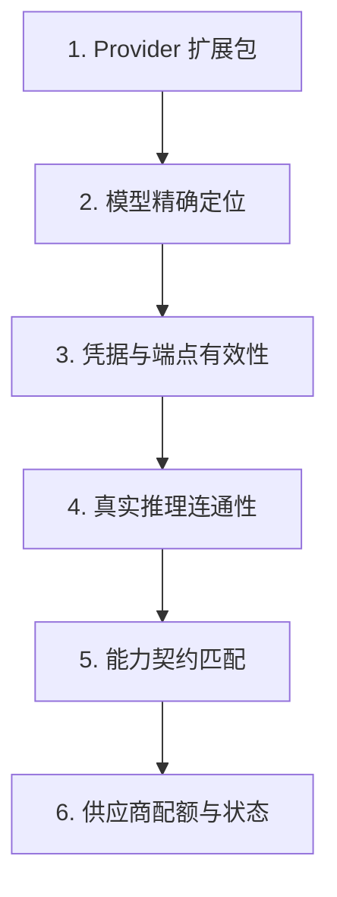

# 排错与诊断

遇到问题时，最关键的是先确定故障究竟发生在哪一个链路边界，而不是盲目改动单项配置。一次成功的 HTTP 响应、界面保存成功的提示、能够获取到模型列表，甚至流式打出几个字，都不能等同于整个对话链路真正闭环。

本页按照具体故障现象组织排查步骤。你不需要在一开始就清空数据库、重装所有依赖或放开全部系统权限，请跟随文档按步骤逐层定位。

## 收集最小诊断证据

在改动任何配置或向社区求助前，请先收集并记录以下核心信息：

- 故障发生的时间与稳定复现步骤
- ChatLuna 的具体版本号与部署方式
- 当前实例名称或实例目录
- 出错页面、宿主平台与对应的会话 ID (Session ID)
- 完整的错误信息、错误码与最近一次配置变更
- 服务端运行日志以及浏览器控制台 (Console) 的报错输出

::: danger 严禁泄露敏感凭据
在向社区或第三方提供日志和排错资料时，必须彻底剔除 `Authorization` 请求头、访问口令、API Key、平台身份凭证、用户聊天内容以及工具执行输出。切勿直接导出并分享整个运行环境或包含私密信息的 `chatluna.yml`。
:::

如果你使用的是已有实例目录，可以先运行内置的静态诊断命令：

```sh
# 列出当前管理的所有实例
chatluna list

# 静态检查当前目录下的配置文件
chatluna doctor config --dir .
```

::: tip
在源码工作区中，也可以通过 `yarn chatluna` 运行等价命令。需要注意的是，`doctor config` 只负责本地配置文件的静态检查，并不会发起网络请求去测试远端模型。
:::

## 启动失败或配置未生效

当实例无法正常启动，或者启动后发现配置根本没有生效时，可以按照以下顺序排查：

### 1. 确认启动目标与根清单优先级

首先确认实际生效的配置文件是哪一个。在所有选项中，`--dir` 参数具有最高优先级；如果在命令行中显式传入了实例名，ChatLuna 将直接选用受管目录，而不会跟随当前的工作目录。

当指定目录后，ChatLuna 会按照如下优先顺序查找根清单：

1. `cordis.yml`
2. `cordis.yaml`
3. `chatluna.yml`
4. `chatluna.yaml`

如果清单中使用了 `include` 引用其他文件，请顺着引用链逐层检查，确认你正在编辑的文件确实位于生效链路中。

### 2. 验证清单语法与服务依赖

确认目标文件无误后，进一步检查配置语法与依赖：

- 检查 YAML 的缩进语法是否正确，避免因层级错位导致配置失效。
- 确认每个配置条目都指定了唯一的稳定 `id`。
- 确认所引用的插件包已正确安装到环境中，且未被标记为 `disabled: true`。
- 检查插件声明所必需的 `inject` 服务依赖是否已全部就绪并成功加载。

### 3. 检查构建产物与开发模式行为

修改了源码或新增插件依赖后，必须先在终端重新执行构建：

```sh
yarn build
```

如果启动时抛出 `ERR_MODULE_NOT_FOUND` 错误，通常并不是 TypeScript 路径配置有误，而是对应插件包的 `lib` 编译产物尚未生成。

此外，开发命令 `chatluna dev .` 会读取当前根清单，使用 tsx 直接加载源码并开启热重载（HMR）；它**不会**启用生产环境下 Supervisor 的崩溃恢复机制与安全模式。因此排查问题时，请注意区分启动恢复报告与常规业务异常。

::: warning 使用修复命令前请先备份
运行 `chatluna repair` 可能会修改工程文件。执行该命令前，请务必先仔细阅读现有的启动诊断报告并备份数据。而 `chatluna report` 命令仅用于查看本地已有的诊断报告与 Issue 草稿，不会自动将任何内容发送至社区。
:::

如果在热重载 (HMR) 之后出现了重复事件监听或工具重名报错，请检查对应资源是否已正确绑定至插件自身的生命周期，切勿尝试使用全局 `Set` 等机制来掩盖生命周期泄漏问题。

## Web 界面打不开、持续加载或离线

遇到 Web 控制台无法访问或状态异常时，可以对照下表，先定位具体发生在哪个层级：

| 现象 | 优先排查项 |
| --- | --- |
| TCP 连接拒绝 (Connection Refused) | 进程存活状态、实际监听地址与端口占用、Docker Compose 服务运行状态 |
| HTTP 401 Unauthorized | 登录会话过期、访问口令变更、反向代理是否丢弃了认证请求头 |
| HTTP 403 Forbidden | `allowRemote` 来源访问限制、操作权限等级，勿直接判定为密码错误 |
| HTTP 404 Not Found | 访问路径、插件挂载路由、前端静态资源构建产物、反向代理路径前缀重写 |
| 首屏展示旧数据但无法进行任何交互 | WebSocket 连接是否已断开，页面当前可能仅展示断线前的本地快照 |
| 仅特定子页面报错打不开 | 对应页面功能包、前端入口编译产物、所依赖的基础服务与 action/state 状态 |

你可以在受信任的本机环境中测试基础健康检查端点：

```sh
# 5028 为默认示例端口，请替换为实际监听端口
curl --fail http://127.0.0.1:5028/api/health
```

::: tip 端点状态局限性
`/api/health` 仅能证明当前的 HTTP 服务进程存活并能正常响应。它并不能代表远端大模型服务、聊天平台 Adapter、数据持久化插件以及 WebSocket 实时通道都处于可用状态。
:::

在配置反向代理或跨网络访问时，还需注意以下网络边界：

1. **协议通道相互独立**：控制台界面的 state/action、对话持久化 Durable SSE 以及实时 Live SSE 属于完全独立的协议通道，排错时不能仅靠重连其中一条通道来判断整体状态。
2. **反向代理配置**：反向代理服务器必须正确配置并转发 WebSocket 握手协议，同时对流式响应接口彻底禁用缓冲 (Buffering)。
3. **Docker 端口映射**：Docker 容器内部网络是互通的，但官方 Compose 配置在宿主机上默认只将端口绑定到了本地回环地址 (`127.0.0.1`)。若需要远程访问，请检查宿主机的公网地址、HTTP 监听配置、来源 IP 限制以及 TLS/HTTPS 证书，切勿试图通过直接关闭认证来排查连通性。

## 忘记管理访问口令

口令无法登录时，首先需要确认当前口令的生效来源究竟是哪一种：是 `server` 清单配置、`CHATLUNA_TOKEN` 环境变量，还是默认的文件模式 (File Mode)。

- **固定口令**：如果你是通过配置文件或 `CHATLUNA_TOKEN` 环境变量指定的口令，重置时必须直接在原配置中修改。此时单纯删除 `auth.json` 并不能覆盖依然存在的静态配置。
- **文件模式**：在文件模式下，`auth.json` 仅存储单向哈希值与签名密钥，无法从中反查出明文口令。如果需要重置，请先停止实例并备份数据，由管理员删除 `auth.json` 并重新启动实例，随后从终端标准输出 (stdout) 日志中获取系统重新生成的随机口令。需要注意的是，这会使之前所有已签名的登录会话立即失效。
- **弱口令自动回退**：如果传入的固定口令未达到强度要求，系统出于安全考量会直接忽略该输入并回退到文件模式。此时请直接查看启动日志获取实际生效的口令，而不是反复尝试那个弱口令。

::: danger 禁止破坏性操作
严禁通过直接删除整个数据目录来重置密码，也千万不要在公开群聊或公共网络中直接分享首次登录的快捷链接。
:::

## 模型已配置却无法回复

如果模型已经配置完成但机器人依然无法回复，可以按照以下执行链路自底向上逐层排查：



1. **Provider 注册状态**：首先检查对应的 Provider 扩展包是否已成功安装并加载。若底层缺少对应 SDK，相关的配置项将不会被挂载为可用的模型实例。
2. **模型精确定位**：检查当前生效规则、预设或具体会话所绑定的 `provider:model` 完整标识，不要只核对全局默认项。
3. **凭据与端点有效性**：核验 API Key、请求 Endpoint、模型标识名、组织架构与区域设置。在 Web 界面中修改凭据时，输入框保持留空通常代表保留原值，并非将其清空。
4. **真实推理连通性**：获取模型列表 (List Models) 或 Discover 接口返回成功，仅能说明凭据通过了元数据探测，并不等同于能够正常对话。必须发起一次端到端的真实推理测试来验证。
5. **能力契约匹配**：确认所选模型是否支持当前场景所需的能力，例如多模态输入、工具调用 (Tool Calls) 或文件附件解析。`chat`、`embed`、`decide` 分属于不同的能力契约，彼此不可替代。
6. **供应商配额与状态**：检查模型返回的 `finish_reason`、供应商具体错误码、调用超时时间，以及服务商账户的配额限额与可用余额。

当服务正在运行时，可以直接执行内置的联通性诊断命令：

```sh
# 默认通过本机 5028 端口诊断已注册的 Providers
# 可通过环境变量 CHATLUNA_BASE 与 CHATLUNA_TOKEN 提供连接凭据
chatluna doctor providers --dir .
```

::: warning 计费注意
无论是因为客户端主动取消、网络意外中断还是接口调用超时，只要模型供应商侧已经开始并产生了计算，通常都会正常计费。
:::

## 平台在线但机器人无响应

平台显示在线只代表协议适配器 (Adapter) 成功与聊天平台的网关建立了长连接。一条消息从接收到送达需要经过多个阶段，建议按以下顺序排查：

### 1. 检查消息激活条件

首先检查场景规则中配置的 Engine、预设、模型与会话归属，并逐一核对唤醒开关：

- **独立激活项**：@机器人、昵称匹配、引用消息回复、随机概率回复以及私聊直接回复均为独立配置项。
- **引用回复默认值**：在通用激活 Schema 中，`allowQuoteReply` 的默认值为 `false`。如果未显式开启，单纯引用机器人的发言并不会唤醒它。
- **抑制与拦截逻辑**：排查会话冷却时间 (Cooldown)、机器人自身消息的过滤机制，以及角色引擎判定是否提前中断了回复流程。
- **Observer 行为特征**：Observer 记录未唤醒的消息仅仅是为了维护上下文滑动窗口，并不会向模型发起推理请求。

### 2. 检查会话路由与末端投递

- **会话路由隔离**：在多机器人、多平台共用或群聊/私聊混合的场景下，消息可能会被路由到不同的会话 ID。请检查命中规则以及上下文字段的实际来源。
- **渲染与投递阶段**：检查末端 `renderer` 或 `transport` 的发送日志。模型侧成功完成推理，并不代表 Adapter 已经顺利将生成的消息投递到了聊天平台。

::: tip 测试环境隔离
排查时请使用独立的测试账号与专属会话，切勿让 v1 与 v2 两个实例同时连接同一个平台机器人账号。另外，首次人格设置流程严格要求主人在私聊中触发，在群聊中无法唤起访谈属于正常设计。
:::

## 绑定码或首次向导卡住

在首次配置向导中，各环节之间存在严格的依赖关系：

```
[模型配置] ──(必须通过真实推理测试)──> [平台配置] ──(必须挂载在线非Web Bot)──> [用途设定]
```

在向导界面中点击「跳过」或「稍后」，并不代表相应步骤的依赖已经验证通过。

使用绑定码时，需严格遵循以下规则：

- **指令发送途径**：必须由管理员在真实聊天平台的私聊窗口中发送 `bind <code>`（是否需要输入前缀 `/` 取决于系统的指令配置），**严禁**在 Web 界面的调试聊天窗口中尝试绑定。
- **身份校验机制**：系统会根据实际接收到该消息的 `sender` 平台账号标识来绑定并确立主人权限。
- **有效期与重试限制**：绑定码的有效时长为 10 分钟。一旦生成新码，之前的旧码立即失效；连续输错 5 次也会导致当前绑定码直接作废。
- **非抢占机制**：普通用户向机器人发送私聊并不会自动获取主人权限，系统仅认准合法绑定流程。

需要说明的是，主人确认状态、向导完成状态、模型就绪状态、当前预设以及人格数据分别存储在独立的数据结构中。执行 `setup` 指令后，系统会从下一条消息开始引导进入访谈。排查时请以指令的实际交互反馈为准，切勿盲目清空预设数据库。

## 预设保存后未生效

预设文件保存后如果没有按照预期生效，请重点排查以下几点：

1. **预设变量作用域**：`system` 区域仅支持不可变的静态变量，所有动态渲染值必须放置在 `context` 区域中。如果控制台抛出 `MutableVariableError`，说明变量区域划分错误，必须调整；系统不会为了容错而降级渲染。
2. **模板包含语法**：引入局部模板文件时，必须采用独立的单行语法：
   ```markdown
   @include ./partial.md
   ```
   使用其他包含语法将无法被模板解析器正确识别。
3. **并发冲突与版本处理**：当遇到外部编辑或多端并发保存时，系统会触发版本冲突 (Revision Conflict)。此时应当重新拉取并手动合并内容，切勿盲目强制覆盖。
4. **生命周期与生效时机**：对预设的改动仅对保存之后新发起的对话生命周期与轮次生效，不会去修改已经发送给模型的历史请求。
5. **Watcher 容错缓存**：当文件监听器 (Watcher) 遇到语法解析失败时，会自动保留内存中上一次解析成功的有效版本。因此磁盘文件内容改变了，并不代表内存中的预设已经成功刷新。

## 工具不见、反复询问或调用被拒

排查工具调用链路时，建议按照「可见性 → 策略过滤 → 执行环境」的顺序层层推进：

1. **注册状态**：对应的功能插件与底层服务是否已正常启用？工具本身是否已经向系统注册？
2. **规则过滤**：检查当前预设或具体场景中配置的允许列表 (Allowlist) 与 Tool Policy。注意：「配置为空列表」与「未配置 Allowlist」是两种完全不同的策略行为。
3. **延迟加载机制**：检查目标工具是否属于延迟加载 (Deferred) 工具。这类工具需要先由语义搜索命中才会注入上下文，在首轮提示词中没看到并不代表工具丢失。
4. **参数 Schema 校验**：检查实际传递给工具的 JSON 结构化入参是否满足 Schema 约束，切勿轻信模型在自然语言回复中的自我解释。
5. **鉴权机制与安全等级**：检查调用者的安全等级 (`level`)、作用范围以及 `ask` 询问通道是否就绪。工具策略配置为 `auto` 并不意味着可以逾越主体的安全权限限制。
6. **工具策略**：确认该工具当前的调用策略究竟是 `自动`、`询问` 还是 `禁用`。设置为 `自动` 只是代表「不再向用户二次确认」，依然需要校验权限等级与审批规则；设置为 `禁用` 也仅仅是隐藏该工具，并不会卸载插件。
7. **执行层故障**：检查本地宿主环境、MCP 服务的连接通道或下游第三方 API 是否正常。多数调用失败往往是执行阶段抛出了异常，而非框架层主动拒绝。

::: danger 避免降级系统安全性
当人工审批超时或缺少交互通道时，系统默认会按照「拒绝执行」处理。千万不要为了省去审批提示，而盲目将所有工具都设为 `auto`、将所有用户权限直接提升至最高级别 `5`，或者直接将宿主机的 Docker Socket 挂载进容器。
:::

## 记忆、定时任务与后台作业异常

排查这些高级功能模块时，必须明确它们各自的行为边界：

### 长期记忆 (Long-term Memory)

- 新建或重置会话并不会清空全局长期记忆。在排查记忆召回时，需明确区分当前 `scopes` 作用域、后台自动索引机制与检索返回条目之间的差异。
- 自动提取记忆功能在默认情况下处于关闭状态。系统发出的 `index` 通知仅代表检测到了主题发生变动，并不代表全文内容已经被直接拼接入提示词。
- 开启会话隔离 (Conversation Isolation) 并不等同于工具搜索具备绝对的私有化数据隔离边界。

### 定时任务 (Cron Jobs)

- 定时任务必须存在真实注册的 Job 实例与执行日志。不能仅凭机器人在聊天中回复“已为您设置好提醒”就判定任务已真正生效。
- 检查任务的时区配置、暂停状态、`when` 调度表达式、`grace` 容错窗口、超时时间预算以及结果投递目标。
- 在 `wakeup` 唤醒任务中，`messages` 上下文仅包含自上一次触发唤醒以来新产生的消息。表达式解析器并非通用的任意 JavaScript 执行环境。

### 后台作业 (Background Jobs)

- 后台作业最终的状态可能会变成 `failed` 或 `cancelled`。收到前端占位提示或任务进入 `settled` 状态，并不代表底层的实际业务逻辑已经成功执行完毕。
- 实例在重启之后，并不会自动接管或恢复之前未完成的挂起进程。
- 在 Docker 容器管理中，`pause` 操作会保留容器进程与内存状态，而 `close` 操作则会直接销毁容器。在执行恢复流程前，请务必确认工作区 (Workspace) 与产物是否已持久化挂载到宿主机。

## 历史记录、轨迹与用量对不上

排查历史记录与 Token 用量分歧时，注意以下底层实现差异：

- **索引标识差异**：底层存储中的 `Session n` 仅代表存储序列中的实体条目序号，它与前端页面中渲染的消息数组下标并不是一一对应的。
- **视图剪裁与摘要**：前端视图会主动剔除内部调试标记 `mark`，同时受到 `cut` 上下文截断与摘要压缩机制的影响。分支分叉 (Fork) 复制采用半开区间，业务层的逻辑 Head 与底层存储的 Session 分支并不处于同一层级。
- **历史回放行为**：
  - `reconstruct`（上下文重建）：仅在本地重组历史提示词，**不会**调用模型，因此不产生任何费用。
  - `replay`（重新生成）：会发起一次全新的模型推理，从而产生新的 Token 计费，但系统**不会**重新触发原流程中关联的外部工具调用。
- **流式状态转换**：SSE 连接输出的 `live` 实时文本属于中间未完成态，不属于最终持久化的 `committed` 消息。若传输中断导致状态变为 `truncated`，应当通过接口拉取 `messages` 完整快照来重置视图，切勿将截断的临时文本直接持久化为完整历史。
- **用量统计口径**：模型 Token 统计、供应商账单金额、系统成本估算与控制台中的实时 `active` 列表在统计口径上各有不同。部分供应商返回的 Input/Output 数据中可能已经扣除了 Prompt 缓存抵扣或包含了 Reasoning Token，如果再次累加就容易导致统计数据偏大。核对统计差异前，请先核查 Billing 插件配置、模型单价基准与统计周期范围。

## 提交问题前

如果跟随上述步骤排查后仍未能定位或解决问题，在向社区提交 Issue 时，请尽量提供以下材料：

- 最小且可复现的完整操作步骤
- 预期行为与实际发生的异常现象对比
- 故障发生的确切时间、系统完整版本号以及相关的错误码
- 当前加载的插件清单，以及经过**彻底脱敏**的服务端日志和浏览器控制台报错
- 说明该现象是否能在全新的独立测试实例中复现、系统是否刚经历过版本升级，以及回退版本后故障是否依然存在

::: danger 严格遵守脱敏要求
严禁将生产数据库文件、`auth.json` 密钥文件、全量环境变量导出或包含真实用户隐私的对话记录直接作为 Issue 附件上传。
:::

## 下一步

- 阅读[配置参考](/api/configuration)了解各服务清单的详细配置选项
- 查阅[权限模式](/manual/usage/permissions)配置合规的主体权限与工具策略
- 查阅[可观测性](/manual/usage/observability)接入链路追踪与指标监控日志
