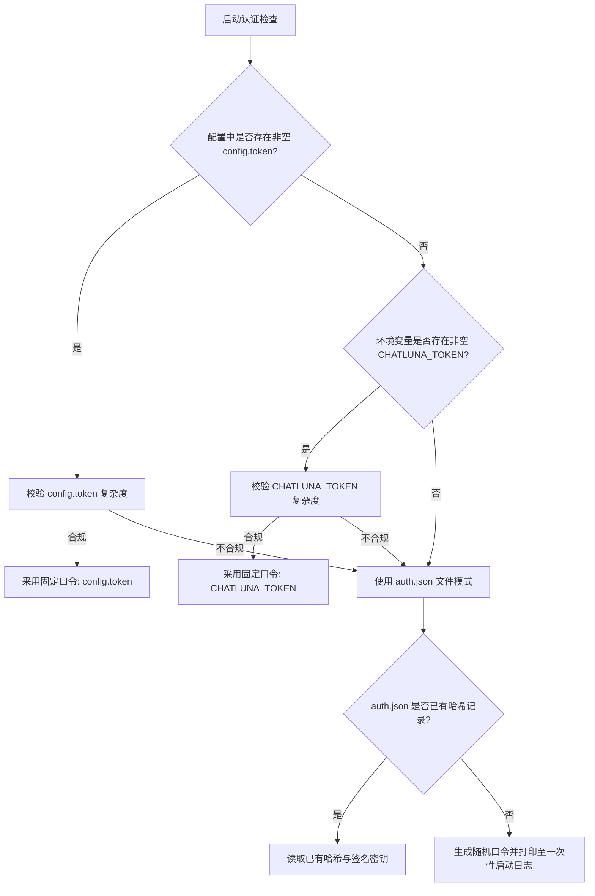
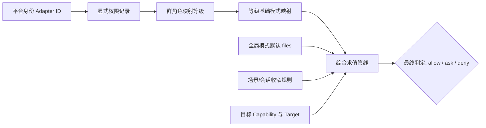

# 安全与权限

ChatLuna 具备安装插件、执行工具和调度外部机器的能力。因此，安全边界必须从管理入口、聊天平台身份、能力权限策略以及操作系统执行环境四个层面同时设计，不能依赖单一访问口令或“沙箱”开关。系统默认保持最小开放原则，管理特权仅授予受信任的管理员。

---

## 1. 管理入口：网络暴露与口令认证

管理入口的保护涉及网络拓扑与应用层认证两个彼此独立的层面。

### 网络监听与部署差异

`@chatluna/server` 默认保护 `/api` 与 `/console`，仅公开登录接口与健康检查（health）端点。其 `allowRemote` 配置键默认值为 `false`；服务最终的监听地址取决于 HTTP 服务自身的配置与宿主部署方式：

- **源码/本机部署**：HTTP 服务通常使用回环监听配置；`allowRemote` 只检查请求来源，不负责绑定网卡。实际监听地址以 HTTP 服务配置为准。
- **官方 Docker 部署**：容器内部通常监听所有网卡（`0.0.0.0`）并允许容器网络内互通；随附的 Docker Compose 模板默认将宿主端口发布到 `127.0.0.1:5028`。

部署远程访问时，必须同时满足以下要求：
1. **地址与端口**：确认实际监听地址与宿主机发布端口。仅将宿主端口发布到 `127.0.0.1` 无法阻止同一容器网络内其他容器的访问；仅将 `allowRemote` 设为 `true` 并不提供传输层安全。
2. **传输加密**：必须在前端部署受信任的反向代理以提供 HTTPS/TLS 支持。
3. **隔离与限制**：限制来源 IP，严禁在公网暴露未经认证的控制台路由或次级管理端口。

### 访问凭证模型

WebUI 当前采用**实例共享访问口令**模式，不包含独立的多用户账号体系：
- 任何持有该共享口令的访问者均对该实例拥有完全管理权限（包括安装可执行包与修改核心配置）。
- 共享口令派生的 Web 会话与聊天平台消息用户的权限等级（Permission Level）相互独立，切勿将普通聊天用户的权限机制误认为 Web 控制台的身份隔离。

系统涉及的三类核心凭据各自独立，不得混淆：
1. **访问口令（Token）**：用于向 WebUI / API 验证管理员身份。
2. **签名 Session Credential**：登录后由系统颁发的会话凭证，具有签名时效性。
3. **模型 Provider Key**：用于调用大语言模型厂商 API 的凭据，由配置或密钥库管理。

### 口令求值顺序、强度约束与重置恢复

系统按以下优先级决定当前的口令模式：

> **注意**：若选中的固定来源口令未通过复杂度校验，系统将**直接回退至文件模式（auth.json）**，不会尝试读取另一个固定口令来源。

#### 手动口令复杂度规则
手动配置的固定口令必须满足以下条件：
- 长度至少 12 个字符；
- 不包含空白字符；
- 至少包含四类字符中的三类（大写字母、小写字母、数字、特殊符号）；
- 全文包含至少 6 种不同的字符。

#### 文件模式与恢复机制
- **随机生成**：当处于文件模式且 `auth.json` 不存在时，系统会在首次启动时自动生成强随机口令，并**仅在启动日志中打印一次**。
- **存储机制**：`auth.json` 仅保存密码哈希值与签名密钥，不支持明文逆向找回。
- **会话失效**：修改或重置文件模式口令会导致当前所有已签名的 Session 凭据立即失效。
- **口令重置**：如果固定口令（`config.token` 或 `CHATLUNA_TOKEN`）仍然存在，仅重置 `auth.json` 无法消除固定口令。如需恢复文件模式认证：
  1. 停止 ChatLuna 实例；
  2. 备份现有数据；
  3. 由系统管理员删除或重命名 `auth.json`（切勿删除业务数据目录）；
  4. 启动实例，在日志中获取新生成的随机口令。具体操作参考[排错文档](/guide/troubleshooting)。

---

## 2. 平台身份、群角色与权限求值

平台端的消息主体由接入的具体 Adapter 提取真实身份（如 IM 用户 ID）。

### 主人身份初始化
- 向导流程通过**主人私聊中发送的绑定码**来确认主人身份，系统不会自动信任第一个发起私聊的用户。
- 确认主人身份时，系统仅为当前**尚无显式权限记录**的主体初始化为 Level 5。若该主体已有显式记录（哪怕已被降级），系统将保留既有记录，不执行强制覆盖。
- 应用主人身份不是 Web 浏览器的管理账号，两者认证机制完全分离。

### 角色映射与求值管线

平台群组的角色存在默认等级映射，但**映射等级并不等同于最终执行权限**：

1. **平台群角色默认映射**：
   - 群主（Owner）：Level 4
   - 管理员（Admin）：Level 3
   - 普通成员（Member）：Level 1
2. **等级到基础模式的默认映射**：
   - Level 0–2：`read-only`
   - Level 3–4：`auto`
   - Level 5：`allow`

系统默认的全局策略模式为 `files`。最终操作是否被允许，由多层规则综合求值决定：

即使某用户等级被评估为 Level 5，若全局模式、会话上下文或针对特定工具的收窄规则设定了限制，该操作仍可能被要求二次确认或直接拒绝。不能仅凭“用户是 Level 5”推断特定工具必定能无阻碍执行。管理员可在管理界面的“权限”页面中审查实际主体、显式记录、群角色与场景规则的生效状态。

---

## 3. 工具策略、能力权限与审批工作流

工具执行控制由两套协同机制组成：面向工具本身的控制开关（`auto` / `ask` / `off`），以及权限系统针对特定能力（Capability）和目标对象（Target）的判定规则。

### 策略控制对照

| 设置项 | 解决的问题 | 无法解决的问题 |
| :--- | :--- | :--- |
| **Tool: `auto`** | 遵循既有权限规则，不强制触发工具专属确认 | 不能绕过底层能力授权与全局策略 |
| **Tool: `ask`** | 工具执行前强制发起人工确认流程 | 不能保证在缺乏可用交互通道时成功审批 |
| **Tool: `off`** | 彻底禁用并对模型隐藏该工具 | 不能回滚或撤销历史执行已产生的副作用 |
| **Permission Mode** | 按主体与能力应用 `read-only`、`files`、`auto`、`allow` 等基准策略 | 不能提供操作系统级别的进程/内核隔离 |
| **Agent / Session 覆盖** | 在特定 Agent 运行期或会话范围内进一步收窄权限 | **只能收窄，不能突破或扩大**底层基础授权 |

### 审批生命周期

- **超时控制**：审批默认等待超时为 **120 秒**。若超时、找不到审批人或缺失通知通道，审批一律判定为**拒绝（Deny）**。
- **`@decide` 审查者**：在 `auto` 模式下，审查者（reviewer）默认为 `@decide`。该角色属于系统自动化评估管线的一环，并不代表模型可以代表管理员随意做出安全背书。
- **验证基准**：在生产上线前，管理员必须对权限管线进行全生命周期验证，确保至少包含以下四种测试用例：
  1. 允许执行（Allow）
  2. 拒绝执行（Deny）
  3. 人工询问审批（Ask - 批准）
  4. 审批超时（Ask - 超时自动拒绝）
- **审计**：权限审查应以审计日志记录与真实的底层工具执行结果为准，不能单纯依赖模型的文本回复进行推断。WebUI 权限日志仅保留近期记录，关键环境须自建外部持久化审计备份。

---

## 4. 外部代码、不可信指令与 MCP 边界

插件、Adapter 扩展、外部 SDK 以及通过标准输入输出（stdio）拉起的 MCP Server 均属于宿主级可执行代码。

### 运行时安全边界规范
- **生命周期 vs 沙箱**：Cordis 的 Fiber 机制仅用于管理组件与服务的资源生命周期（装载、卸载、依赖引用），**不提供针对恶意代码的进程级沙箱隔离**。安全模式（Safe Mode）属于系统故障恢复手段，不可作为恶意代码的隔离环境。
- **间接提示注入（Indirect Prompt Injection）**：网页抓取内容、知识库检索文档、外部工具输出及技能描述均属于不可信的外部输入数据。它们不能获得高于当前消息主体的授权边界。技能的动态激活与工具路由不得绕过已建立的审批规则。
- **System 提示词属性**：稳定的 System 提示词前缀主要用于提示词缓存（Prompt Caching）优化，处于 Context 中的数据并不会因为模型对其认知而自动升级为可信任源。

### MCP 与第三方扩展准则
- **本地 MCP（stdio）**：本地拉起的命令直接继承当前运行 ChatLuna 服务主进程的操作系统权限。
- **远端 MCP（SSE/HTTP）**：必须确保远端端点完全可信。远端服务有权记录并处理由本地传输的调用数据与访问凭据；服务暴露的只读查询工具并不等同于其实际内部逻辑仅有只读影响。
- **Skill 与 Forge 扩展**：
  - 导入外部 Skill 必须对其附带的脚本及依赖进行前置审计。
  - Forge 体系中，“工作区内的文件编辑”与“宿主系统层面的发布部署”属于两个独立的能力，必须分别授权。

---

## 5. 机器环境、容器隔离与子代理

ChatLuna 支持通过本地环境、SSH 连接、Docker 容器以及云端沙箱（如 E2B）调度机器能力。隔离等级完全取决于后端的底层配置。

### 隔离与挂载风险
- **环境复用**：`local` 与 `ssh` 可能会直接操作真实主机的文件系统，缺乏文件层面的虚拟化隔离。
- **容器与宿主穿透**：
  - 严禁将宿主机根目录或包含敏感凭据的主机目录直接挂载至工作容器内部。
  - Docker socket（`/var/run/docker.sock`）可提供宿主级管理能力。普通部署不要挂载；只有受信任、隔离主机上的明确需求才考虑可选 sandbox 服务，容器隔离本身不能消除该风险。
- **凭据下发**：禁止将宿主运行环境的所有环境变量和 Secret 无差别注入到外部工具执行器或子代理中。

### 会话生命周期与控制边界
- **上下文继承（Context Inheritance）**：设置 `inherit: none` 或 `inherit: summary` 仅作用于父子代理之间的 Prompt 输入上下文传递，**不提供任何文件系统或操作系统层面的隔离**。
- **后台异步（Background）**：将任务标记为 `background` 仅变更其任务调度与等待模式，不代表其执行权限得到了降低。
- **取消机制（Cancel / Abort）**：执行 `cancel` 或 `abort` 仅能阻止该操作后续未执行的指令序列，**无法撤销已经产生的副作用**（如已发出的网络请求、已写入磁盘的数据、已发送的平台消息或已产生的计费调用）。
- **生命周期状态**：
  - `Docker pause`：仅冻结容器内进程，容器实例与挂载卷依然保留。
  - `Docker close`：会直接销毁并删除目标容器。
  - WebUI 中操作的“暂停/停止”不代表数据已完成安全持久化备份，容器销毁时未挂载数据将会丢失。

---

## 6. 运行时自管理（Runtime Policy）

ChatLuna 提供对自身的运行时检查与控制能力，其执行受 `runtime policy` 约束。

- **策略模式**：
  - `inspect`（默认）：允许对自身运行状态进行只读自省，但哪怕是只读操作也需要人工确认；写操作（修改自身配置、变更组件）直接拒绝。
  - `off`：彻底关闭一切自管理能力。
  - `full`：开放自管理写操作，但关键写操作仍必须逐次经过人工审批；发起 Daemon 级别的服务重启操作时，系统会触发二次确认机制。
- **降级拒绝**：若当前没有可用的交互通道用于推送自管理审批，系统将直接**拒绝执行**该请求。
- **脱敏局限**：系统的脱敏输出机制旨在减少凭据意外打印，但不保证任意组件输出的调试日志均绝对不含敏感信息。
- **不可扩散性**：动态安装代码包、修改配置清单以及重启服务均属于具有独立副作用的操作，管理员的一次批准仅对当前单次操作生效，不得视为赋予系统长期的自治权限。

---

## 7. 数据与备份安全

ChatLuna 的本地持久化目录包含敏感的业务资产与认证信息，需实施严格的访问控制。

### 敏感数据构成
- **持久化记录**：聊天会话、Trace 调用链、记忆存储（Memory）、账单流水及配置快照中可能包含明文个人信息、平台真实 ID 及服务内部绝对路径。
- **记忆隔离边界**：新建聊天对话**不会**清空底层长期记忆。配置项 `conversation isolation` 仅限制自动索引检索的上下文边界，并不构成物理级别的绝对隔离，也不杜绝语义层面的交叉推断。

### 备份范围与密文安全
进行系统迁移或备份时，必须覆盖以下资产：
1. **配置文件清单**：主配置及其所有 `include` 引入的子配置文件。
2. **依赖锁定文件**：项目依赖清单及对应的包锁文件（`package.json`、锁文件等）。
3. **数据库文件**：核心 SQLite 数据库或其他支持的数据库存储文件。
4. **数据存储目录**：完整的 `CHATLUNA_DATA` 目录。
5. **外部工作区**：分配给机器执行器的外部工作区持久化卷。

> **核心密钥依赖**：
> 机器凭据的解密严重依赖存储于数据目录中的 `.secret-key`。如果备份丢失该密钥文件，已加密存储的机器认证凭据将全部无法恢复。备份策略必须保证加密凭据与 `.secret-key` 保持原子性的一致备份，且备份介质须严格加密保存。

针对运行中的数据库，应使用数据库原生的热备份工具导出，或在确认写入已完全停止后复制数据文件，以避免数据不一致。

---

## 关联阅读

- [工具、技能与 MCP](/guide/capabilities)
- [机器管理](/guide/machines)
- [配置参考](/reference/configuration)
- [排错与故障恢复](/guide/troubleshooting)
