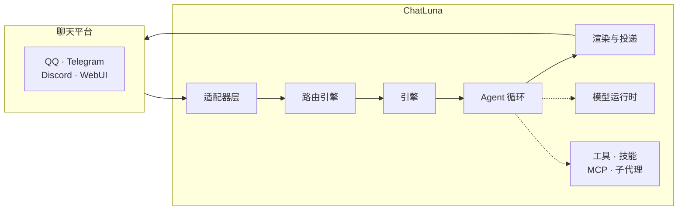

# 介绍

**可组合的 Agent Harness，接入任何聊天平台。**

ChatLuna 把大模型、工具和角色编排在一起，变成真正跑在聊天软件里的机器人。它运行在 Cordis 4 微内核上，平台接入、模型调用、会话编排都是插件——一个实例可以同时撑起多个机器人账号、多套人设预设和不同的模型后端。

::: warning
ChatLuna v2 不是 v1 插件的升级补丁，而是一套需要独立部署的应用程序，目前处于 alpha 阶段。它内置了自己的 WebUI 控制台、CLI 与插件体系，不能直接覆盖 v1 的 Koishi 实例升级。迁移方法见[从 v1 迁移](/cookbook/migration)。
:::

## 特性

### 开箱即用的控制台

内置 WebUI 控制台。首次启动后，在网页中连接模型提供商、配置聊天平台、绑定主人，就可以开始对话。

### 可组合的能力系统

各项能力都是独立的配置单元，可以按需组合：

- **预设与角色（Preset / Character）**：定制机器人的性格、系统提示词与展示设定。
- **工具（Tool）**：赋予机器人操作环境的能力，包括文件读写、命令执行与网络请求。
- **技能（Skill）**：按需动态加载的领域知识与任务指引。
- **模型上下文协议（MCP）**：原生接入外部 MCP 工具服务，挂载进统一的工具体系。
- **子代理（Subagent）**：把耗时或独立的复杂任务委托给隔离的子会话处理。
- **机器与工作区（Machine）**：指定工具的运行载体，支持本地宿主、Docker 容器或远程 SSH。
- **权限控制（Permission）**：精细化约束工具调用策略，包括直接执行、人工批准与禁止调用。
- **定时与后台任务（Schedule / Background）**：管理无需即时交互的周期任务与异步流水线。

### 决策过程与轨迹可查

每轮对话的上下文、工具调用参数和模型原始请求都会追加写入日志。在「轨迹」页中可以回放任意一轮对话，回放不会重新调用模型，也不会重复执行工具。

### 面向开发者设计

- **全栈 TypeScript**：框架服务、事件与上下文都有完整的类型定义与推导。
- **生命周期可逆**：依托 Cordis 上下文机制，插件注册的监听器、定时器与工具会在插件卸载时被彻底回收，天然支持热重载。
- **微内核可扩展**：Agent 循环、模型运行时、提示词分区与工具加载层都是清晰解耦的可替换扩展点。

## 运行架构

一个运行中的 ChatLuna 实例，是由清单文件（`chatluna.yml`）装配起来的插件树。一条消息的旅程是：

1. **接收与路由**：适配器接收平台消息，路由按场景规则分发给对应的引擎与角色。
2. **Agent 循环**：按「模型推理 → 工具调用 → 再次推理」驱动决策，工具、技能、MCP 与子代理都在这里被调用。
3. **渲染与投递**：把回复组织成文本或媒体，发回目标平台。

整个过程都会追加写入日志与轨迹，可以随时回溯。

### 为 Koishi v5 预备好

Koishi 官方正在推进 [Koishi v5（迁移到 Cordis 内核）](https://forum.koishi.xyz/t/topic/7901)。ChatLuna v2 没有分叉 Cordis，而是直接使用官方 Cordis 生态；Koishi v5 发布后，ChatLuna v2 会直接采用它作为 IM 层，两者共存于同一棵 Cordis 服务树中。

在此之前，ChatLuna v2 以补丁形式让 `@koishijs/core` 跑在 Cordis 4 上，再通过 `@chatluna/koishi-loader` 加载一部分 Koishi 插件，因此可以继续使用 Koishi API。

两者的关系如下图：Cordis 是共同的底座，ChatLuna 负责 Agent Harness，Koishi 负责自己的生态，中间通过 IM 对话能力连在同一棵插件树上。

<svg viewBox="0 0 720 360" xmlns="http://www.w3.org/2000/svg" font-family="inherit">
  <!-- 左块：ChatLuna -->
  <rect x="40" y="64" width="236" height="220" rx="14" class="venn-left"/>
  <text x="158" y="102" text-anchor="middle" class="venn-label">ChatLuna v2</text>
  <text x="158" y="150" text-anchor="middle" class="venn-part">Agent Harness</text>
  <text x="158" y="178" text-anchor="middle" class="venn-sub">Agent 循环 · 模型运行时</text>
  <text x="158" y="202" text-anchor="middle" class="venn-sub">预设 · 角色 · 场景规则</text>
  <text x="158" y="226" text-anchor="middle" class="venn-sub">工具 · 技能 · MCP · 子代理</text>
  <!-- 右块：Koishi -->
  <rect x="444" y="64" width="236" height="220" rx="14" class="venn-right"/>
  <text x="562" y="102" text-anchor="middle" class="venn-label">Koishi</text>
  <text x="562" y="150" text-anchor="middle" class="venn-part">Koishi 生态</text>
  <text x="562" y="178" text-anchor="middle" class="venn-sub">插件市场 · 指令 · 中间件</text>
  <text x="562" y="202" text-anchor="middle" class="venn-sub">平台适配 · 数据库</text>
  <text x="562" y="226" text-anchor="middle" class="venn-sub">Satori 协议</text>
  <!-- 中间桥：IM 对话 -->
  <rect x="292" y="128" width="136" height="92" rx="14" class="venn-midbox"/>
  <text x="360" y="166" text-anchor="middle" class="venn-mid">IM 对话</text>
  <text x="360" y="192" text-anchor="middle" class="venn-sub">同一棵插件树</text>
  <!-- Cordis 底座 -->
  <rect x="40" y="300" width="640" height="48" rx="10" class="venn-base"/>
  <text x="360" y="330" text-anchor="middle" class="venn-base-text">Cordis 生态（官方插件 · 服务 · 生命周期）</text>
</svg>

## 下一步

- [起步指南](./starter/)：安装并启动你的第一个 ChatLuna v2 实例。
- [从 v1 迁移](/cookbook/migration)：了解 v1 与 v2 的差异，并迁移现有配置与数据。
