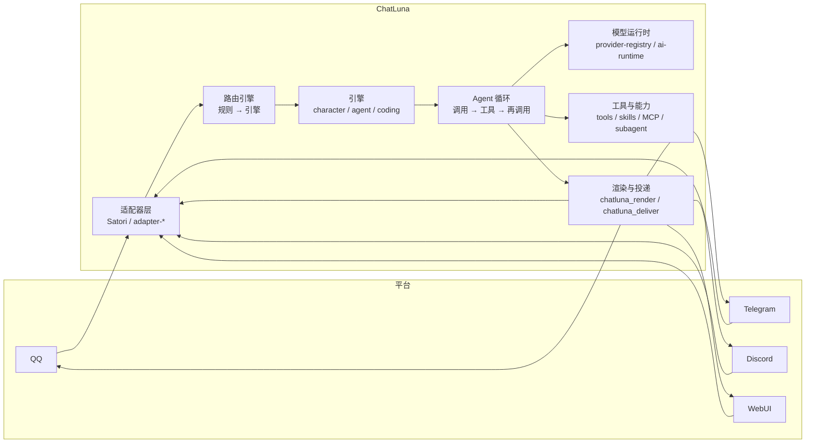

# 介绍

ChatLuna v2 是专为即时通讯 (IM) 场景设计的 Agent Harness，基于 Cordis 4 微内核构建。它将「平台适配」「模型调用」与「会话编排」拆解为各自独立的插件 (Plugin)，允许你在单一实例中并发管理多个机器人账号、多种人设预设以及不同的大语言模型后端。

ChatLuna v2 针对 Cordis 4 架构进行了全面重写，目前处于 alpha 阶段。

::: warning
ChatLuna v2 并非旧版 v1 插件的升级补丁，而是一套需要独立部署的应用程序。它内置了 WebUI 控制台、CLI 命令行以及独立的插件运行体系。如果你仍在使用 v1，请勿直接覆盖升级。
:::

## 运行架构

运行中的 ChatLuna 实例是由清单文件（`chatluna.yml`）装配而成的插件树。平台适配器负责接收外部平台消息并接入会话，路由引擎负责指派响应的角色与引擎，Agent 循环驱动模型与工具交互完成决策，最终由渲染与投递链路将回复送达对应平台：

1. **接收与路由**：适配器层捕获外部平台的消息事件，路由引擎依据配置规则分发给对应的对话引擎或角色预设。
2. **Agent 循环**：按照「模型推理 → 工具调用 → 再次推理」的标准循环驱动会话决策。
3. **能力与执行**：模型运行时提供底层 LLM 推理接口，工具、技能、MCP 服务器与子代理共同构成可执行的上下文环境。
4. **渲染与回传**：渲染层将回复组织为富文本或媒体格式，投递层负责将其安全推回目标聊天平台。

会话执行的全生命周期都会被完整记录至审计日志与调用轨迹中，方便随时回溯与排查。

## 核心特性

### 开箱即用的控制台

ChatLuna 内置了图形化的 WebUI 控制台。首次启动后，只需在网页端完成少量基础设置即可快速开始对话：

- 连接模型服务提供方 (`Provider`)
- 配置聊天平台适配器 (`Adapter`)
- 绑定管理员身份与主人权限 (`Master`)

### 可组合的能力系统

ChatLuna 将 Harness 的各项能力解耦为高度独立的配置单元，你可以根据实际需要灵活组合或单独开启：

- **预设与角色 (Preset / Character)**：定制机器人的性格特点、系统提示词 (System Prompt) 与展示设定。
- **工具 (Tool)**：赋予机器人操作环境的能力，包括文件读写、指令执行与网络请求等具体可执行动作。
- **技能 (Skill)**：按需动态加载的领域知识库与任务指引文档。
- **模型上下文协议 (MCP)**：原生接入外部 MCP 工具服务，直接挂载进统一的工具体系中。
- **子代理 (Subagent)**：将耗时较长或彼此独立的复杂任务委托给隔离的子会话处理。
- **机器与工作区 (Machine)**：指定具体工具的运行载体，支持本地宿主、Docker 容器或远程 SSH 环境。
- **权限控制 (Permission)**：精细化约束工具调用策略，包括直接执行、人工批准与禁止调用。
- **定时与后台任务 (Schedule / Background)**：管理无需人工即时交互的自动化周期任务与异步流水线。

### 为 Koishi v5 预备好

此前，Koishi 官方宣布正在推进 [Koishi v5（迁移到 Cordis 内核）](https://forum.koishi.xyz/t/topic/7901)。

ChatLuna v2 并没有单独分叉 Cordis，而是尽可能直接拥抱官方 Cordis 生态。在 Koishi v5 发布后，ChatLuna v2 与 Koishi v5 将能够共存于同一棵 Cordis 服务树中，Koishi v5 也可以作为 ChatLuna v2 插件的运行依赖。

我们可以通过下面的交集图来理解两者的定位：Cordis 构成统一的底层底座，ChatLuna 专注于独立的 Agent Harness 体系，中间的 IM 对话能力与 Koishi 平台生态重叠互通，而 Koishi 丰富的生态插件也能继续保持其独立性：

<svg viewBox="0 0 640 360" xmlns="http://www.w3.org/2000/svg" font-family="inherit">
  <!-- Cordis 底座 -->
  <rect x="20" y="290" width="600" height="56" rx="10" class="venn-base"/>
  <text x="320" y="324" text-anchor="middle" class="venn-base-text">Cordis 生态（官方插件 · 服务 · 生命周期）</text>
  <!-- 左圆 ChatLuna -->
  <circle cx="245" cy="150" r="135" class="venn-left"/>
  <text x="185" y="72" text-anchor="middle" class="venn-label">ChatLuna v2</text>
  <text x="170" y="140" text-anchor="middle" class="venn-part">Agent Harness</text>
  <text x="170" y="162" text-anchor="middle" class="venn-sub">Agent 循环 · 模型运行时</text>
  <text x="170" y="182" text-anchor="middle" class="venn-sub">工具 · 技能 · MCP · 子代理</text>
  <!-- 右圆 Koishi -->
  <circle cx="395" cy="150" r="135" class="venn-right"/>
  <text x="455" y="72" text-anchor="middle" class="venn-label">Koishi v5</text>
  <text x="470" y="140" text-anchor="middle" class="venn-part">Koishi 生态</text>
  <text x="470" y="162" text-anchor="middle" class="venn-sub">插件市场 · 指令 · 中间件</text>
  <text x="470" y="182" text-anchor="middle" class="venn-sub">平台适配 · 数据库</text>
  <!-- 中间重叠 -->
  <text x="320" y="150" text-anchor="middle" class="venn-mid">IM 对话</text>
  <text x="320" y="170" text-anchor="middle" class="venn-sub">同一棵插件树</text>
</svg>

### 决策过程与轨迹可查

每一次对话交互的细节均以追加写入的方式记录在审计日志中，涵盖完整的会话上下文、工具调用参数、模型原始请求以及各项决策边界。

在控制台的「轨迹」页面中，你可以回放任意一轮对话的完整推导链路。在重放或重建请求时，系统不会重新调用外部模型，也不会重复执行已完成的外部工具动作。

### 面向开发者设计

- **全栈 TypeScript**：框架服务 (`Service`)、事件 (`Event`) 与上下文均具备严格完整的类型定义与类型推导支持。
- **生命周期可逆**：依托 Cordis 上下文机制，插件声明的监听器、定时器与工具等资源均会在插件停用或卸载时被彻底清理，天然支持开发模式下的热重载 (HMR)。
- **微内核可扩展**：Agent 循环、模型运行时、提示词分区方案与工具加载层均为清晰解耦的可替换扩展点。

## 下一步

- [起步指南](./starter/)：安装并启动你的第一个 ChatLuna v2 实例。
- [从 v1 迁移](/cookbook/migration)：了解 v1 与 v2 的差异，并迁移现有配置与数据。
