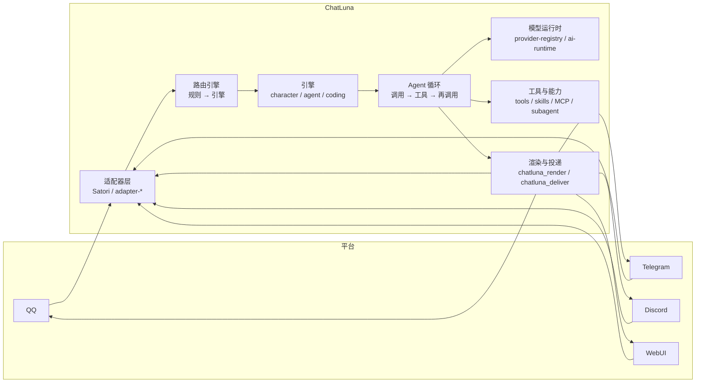

# 介绍

**可组合的 Agent Harness，接入任何聊天平台。**

ChatLuna 把大模型、工具和角色编排在一起，变成真正跑在聊天软件里的机器人。它运行在 Cordis 4 微内核上，平台接入、模型调用、会话编排都是插件——一个实例可以同时撑起多个机器人账号、多套人设预设和不同的模型后端。

::: warning
ChatLuna v2 不是 v1 插件的升级补丁，而是一套需要独立部署的应用程序，目前处于 alpha 阶段。它内置了自己的 WebUI 控制台、CLI 与插件体系，不能直接覆盖 v1 的 Koishi 实例升级。迁移方法见[从 v1 迁移](/cookbook/migration)。
:::

## 特性

### 开箱即用的控制台

ChatLuna 内置了图形化的 WebUI 控制台。首次启动后，只需在网页端完成少量基础设置即可开始对话：

- 连接模型服务提供方（Provider）
- 配置聊天平台适配器（Adapter）
- 绑定管理员身份与主人权限（Master）

### 可组合的能力系统

ChatLuna 把 Harness 的各项能力解耦为独立的配置单元，可以按需组合或单独开启：

- **预设与角色（Preset / Character）**：定制机器人的性格、系统提示词与展示设定。
- **工具（Tool）**：赋予机器人操作环境的能力，包括文件读写、命令执行与网络请求。
- **技能（Skill）**：按需动态加载的领域知识与任务指引。
- **模型上下文协议（MCP）**：原生接入外部 MCP 工具服务，挂载进统一的工具体系。
- **子代理（Subagent）**：把耗时或独立的复杂任务委托给隔离的子会话处理。
- **机器与工作区（Machine）**：指定工具的运行载体，支持本地宿主、Docker 容器或远程 SSH。
- **权限控制（Permission）**：精细化约束工具调用策略，包括直接执行、人工批准与禁止调用。
- **定时与后台任务（Schedule / Background）**：管理无需即时交互的周期任务与异步流水线。

### 决策过程与轨迹可查

每一次对话交互的细节都会追加写入审计日志，涵盖完整会话上下文、工具调用参数、模型原始请求与各项决策边界。在控制台的「轨迹」页中，你可以回放任意一轮对话的完整推导链路；回放不会重新调用模型，也不会重复执行已完成的外部工具动作。

### 面向开发者设计

- **全栈 TypeScript**：框架服务、事件与上下文都有完整的类型定义与推导。
- **生命周期可逆**：依托 Cordis 上下文机制，插件注册的监听器、定时器与工具会在插件卸载时被彻底回收，天然支持热重载。
- **微内核可扩展**：Agent 循环、模型运行时、提示词分区与工具加载层都是清晰解耦的可替换扩展点。

## 运行架构

一个运行中的 ChatLuna 实例，是由清单文件（`chatluna.yml`）装配起来的插件树。消息从平台进来，经过路由指派给角色与引擎，由 Agent 循环驱动模型与工具完成决策，最后由渲染与投递链路把回复送回平台：

1. **接收与路由**：适配器捕获平台消息，路由引擎按场景规则分发给对应的引擎与角色预设。
2. **Agent 循环**：按「模型推理 → 工具调用 → 再次推理」的标准循环驱动会话决策。
3. **能力与执行**：模型运行时提供底层推理接口，工具、技能、MCP 与子代理共同构成可执行的上下文。
4. **渲染与回传**：渲染层把回复组织成富文本或媒体格式，投递层负责安全推回目标平台。

会话执行的完整生命周期都会以追加写入的方式记入日志与调用轨迹，可以随时回溯。

### 为 Koishi v5 预备好

此前，Koishi 官方宣布正在推进 [Koishi v5（迁移到 Cordis 内核）](https://forum.koishi.xyz/t/topic/7901)。

ChatLuna v2 并没有单独分叉 Cordis，而是尽可能直接拥抱官方 Cordis 生态。在 Koishi v5 发布后，ChatLuna v2 会直接采用 Koishi v5 作为自己的 IM 层，两者也将能够共存于同一棵 Cordis 服务树中。

在此之前，ChatLuna v2 以补丁的形式让 `@koishijs/core` 跑在 Cordis 4 上，再通过 `@chatluna/koishi-loader` 让一部分 Koishi 插件能在 ChatLuna 实例里运行。这让 ChatLuna v2 能继续使用 Koishi API，并兼容一部分 Koishi 插件。

我们可以通过下面的交集图来理解两者的定位：Cordis 构成统一的底层底座，ChatLuna 专注于独立的 Agent Harness 体系，中间的 IM 对话能力与 Koishi 平台生态重叠互通，而 Koishi 丰富的生态插件也能继续保持其独立性：

<svg viewBox="0 0 720 420" xmlns="http://www.w3.org/2000/svg" font-family="inherit">
  <!-- Cordis 底座 -->
  <rect x="40" y="336" width="640" height="56" rx="10" class="venn-base"/>
  <text x="360" y="370" text-anchor="middle" class="venn-base-text">Cordis 生态（官方插件 · 服务 · 生命周期）</text>
  <!-- 左圆 ChatLuna -->
  <circle cx="268" cy="176" r="150" class="venn-left"/>
  <text x="196" y="104" text-anchor="middle" class="venn-label">ChatLuna v2</text>
  <text x="188" y="158" text-anchor="middle" class="venn-part">Agent Harness</text>
  <text x="188" y="182" text-anchor="middle" class="venn-sub">Agent 循环 · 模型运行时</text>
  <text x="188" y="204" text-anchor="middle" class="venn-sub">工具 · 技能 · MCP · 子代理</text>
  <!-- 右圆 Koishi -->
  <circle cx="452" cy="176" r="150" class="venn-right"/>
  <text x="524" y="104" text-anchor="middle" class="venn-label">Koishi</text>
  <text x="532" y="158" text-anchor="middle" class="venn-part">Koishi 生态</text>
  <text x="532" y="182" text-anchor="middle" class="venn-sub">插件市场 · 指令 · 中间件</text>
  <text x="532" y="204" text-anchor="middle" class="venn-sub">平台适配 · 数据库</text>
  <!-- 中间重叠 -->
  <text x="360" y="168" text-anchor="middle" class="venn-mid">IM 对话</text>
  <text x="360" y="190" text-anchor="middle" class="venn-sub">同一棵插件树</text>
</svg>

## 下一步

- [起步指南](./starter/)：安装并启动你的第一个 ChatLuna v2 实例。
- [从 v1 迁移](/cookbook/migration)：了解 v1 与 v2 的差异，并迁移现有配置与数据。
