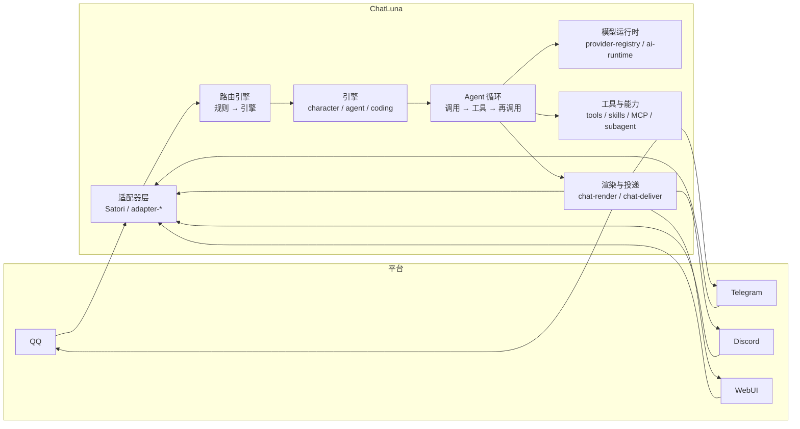

# 介绍

ChatLuna v2 是为 IM 平台深度设计的 Agent Harness，基于 Cordis 4 构建。它将「接入聊天平台」「调用大语言模型」与「组织对话能力」拆分为互相独立的插件 (Plugin)，允许你在同一个实例中同时运行多个机器人、多种角色以及多种模型后端。

ChatLuna v2 面向 Cordis 4 进行了重写，目前处于 alpha 阶段。

::: warning
ChatLuna v2 不是 v1 插件的升级包，而是一套需要独立部署的应用程序，内置了 WebUI 控制台、命令行界面以及独立的插件体系。如果你正在运行 v1，请勿直接覆盖升级。
:::

## 运行架构

运行中的 ChatLuna 实例是由清单文件（`chatluna.yml`）装配起来的插件树。平台适配器将外部消息送入会话，路由引擎决定由哪个预设角色响应，Agent 循环负责驱动模型与工具交互，最终由渲染与投递链路将回复送回原平台：

1. **接收与路由**：适配器层接收外部平台消息，路由引擎根据规则匹配对应的引擎或角色预设。
2. **Agent 循环**：按照「模型调用 → 工具执行 → 再次调用」的循环驱动对话决策。
3. **能力与执行**：模型运行时提供 LLM 推理接口，工具、技能、MCP 服务器与子代理提供可执行上下文。
4. **渲染与回传**：渲染层处理输出格式，投递层将消息发送回外部平台。

整个生命周期均会写入可检查的会话日志与调用轨迹。

## 核心特性

### 开箱即用的控制台

ChatLuna 自带 WebUI 控制台。你可以通过图形界面完成以下基础设置并立即开始对话：

- 连接模型服务提供方 (Provider)
- 配置聊天平台适配器 (Adapter)
- 绑定管理员/主人身份 (Master)

### 可组合的能力系统

Harness 的能力被解耦为独立的配置单元，支持按需组合与单独启用：

- **预设与角色 (Preset / Character)**：定义人格、系统提示词 (System Prompt) 与外貌设定。
- **工具 (Tool)**：提供文件读写、命令执行、网络请求等具体可执行动作。
- **技能 (Skill)**：提供可按需动态加载的专长说明与指南。
- **模型上下文协议 (MCP)**：将外部 MCP 工具服务器直接挂载至统一的工具体系中。
- **子代理 (Subagent)**：将耗时较长或独立的任务派发至隔离的子会话中执行。
- **机器与工作区 (Machine)**：指定工具的执行运行环境，支持宿主本机、Docker 容器或远程 SSH 环境。
- **权限控制 (Permission)**：精确定义动作的执行策略（直接执行、需要批准或禁止调用）。
- **定时与后台任务 (Schedule / Background)**：管理无需人工干预的自动化定时任务与后台流水线。

### 为 Koishi v5 预备好

在早些时候，Shigma 曾宣布正在推进的 [Koishi v5（迁移到 Cordis 内核）](https://forum.koishi.xyz/t/topic/7901) 。

由于 ChatLuna V2 不分叉单独的 Cordis，尽可能的使用官方 Cordis 生态，我们可以在 Koishi V5 发布后，让 Koishi V5 和 ChatLuna V2 运行在相同的 Cordis 树上，并将 Koishi V5 也作为 ChatLuna V2 部分插件的依赖。

可以这样理解：Cordis 是整个大生态，ChatLuna 的 Harness 部分独立，ChatLuna 的 IM Chat 部分可以覆盖到 Koishi V5 的圆圈，而 Koishi V5 的部分生态则是独立在 Koishi 右圆圈的：

<svg viewBox="0 0 640 360" xmlns="http://www.w3.org/2000/svg" font-family="inherit">
  <!-- Cordis 底座 -->
  <rect x="20" y="290" width="600" height="56" rx="10" class="venn-base"/>
  <text x="320" y="324" text-anchor="middle" class="venn-base-text">Cordis 生态（官方插件 · 服务 · 生命周期）</text>
  <!-- 左圆 ChatLuna -->
  <circle cx="245" cy="150" r="135" class="venn-left"/>
  <text x="185" y="72" text-anchor="middle" class="venn-label">ChatLuna v2</text>
  <text x="170" y="140" text-anchor="middle" class="venn-part">Agent Harness</text>
  <text x="170" y="162" text-anchor="middle" class="venn-sub">Agent 循环 · 模型运行时</text>
  <text x="170" y="182" text-anchor="middle" class="venn-sub">工具 · 技能 · MCP · 子代理</text>
  <!-- 右圆 Koishi -->
  <circle cx="395" cy="150" r="135" class="venn-right"/>
  <text x="455" y="72" text-anchor="middle" class="venn-label">Koishi v5</text>
  <text x="470" y="140" text-anchor="middle" class="venn-part">Koishi 生态</text>
  <text x="470" y="162" text-anchor="middle" class="venn-sub">插件市场 · 指令 · 中间件</text>
  <text x="470" y="182" text-anchor="middle" class="venn-sub">平台适配 · 数据库</text>
  <!-- 中间重叠 -->
  <text x="320" y="150" text-anchor="middle" class="venn-mid">IM 对话</text>
  <text x="320" y="170" text-anchor="middle" class="venn-sub">同一棵插件树</text>
</svg>

### 决策过程与轨迹可查

每次对话的执行细节均以追加方式记录在审计日志中，包含消息上下文、工具调用参数、模型原始请求以及决策边界。

前往控制台的「轨迹」页面，可以回放任意一轮对话的完整推导过程。回放或请求重建时，系统不会重新调用外部模型，也不会重复执行已完成的外部工具。

### 面向开发者设计

- **全栈 TypeScript**：框架服务 (Service)、事件 (Event) 及上下文均提供完整的类型定义。
- **生命周期可逆**：基于 Cordis 上下文体系，插件注册的所有资源（监听器、定时器、工具等）在插件停用或卸载时会自动完成清理，支持开发模式下的热重载 (HMR)。
- **微内核可扩展**：Agent 循环、模型运行时、提示词分区方案与工具加载层均为可替换的扩展点。

## 下一步

- [起步指南](./starter/)：安装并启动你的第一个 ChatLuna v2 实例。
- [从 v1 迁移](/cookbook/migration)：了解 v1 与 v2 的差异，并迁移现有配置与数据。
