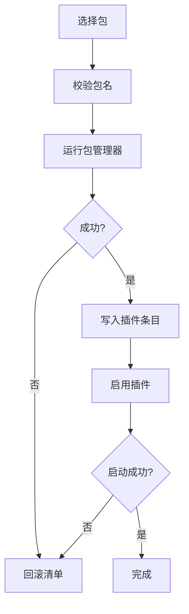

# 插件与市场

::: tip
ChatLuna 的绝大部分能力都来自插件：聊天平台、模型提供商、工具、技能、记忆和轨迹都是插件。本节介绍如何在控制台中安装、启用和管理它们。
:::

插件挂载在系统的「插件树」上：基础服务是根，业务插件挂在上面，并通过分组共享或隔离服务。正因如此，安装、升级和卸载插件时需要格外注意，它直接关系到实例能否稳定运行。

## 认识市场

在左侧导航栏的「插件」分组中点击「市场」，所有可用插件以卡片形式展示，可以搜索和浏览。

- **插件源**：市场可以同时聚合多个源，每个源有优先级，同名插件采用高优先级源的信息。
- **索引缓存**：索引缓存在本地，默认每 10 分钟刷新一次。网络故障时仍可以用缓存展示列表。
- **兼容性检查**：每个插件都会检查与当前 ChatLuna 版本的兼容性，不兼容时卡片上会提示，建议不要安装。

::: tip
「市场里看得见，但就是装不上」通常不是网络问题，而是插件与当前版本不兼容或已被作者废弃。
:::

## 安装插件

在「市场」页面找到插件，点击卡片右下角的「安装」。安装是一次完整的事务：

安装前系统会记录配置清单和依赖版本的快照。下载中断、依赖报错或启用失败时都会回滚，不留下残留文件。所有安装、升级和卸载操作在同一个队列中串行执行，避免同时改写配置。

安装完成后按钮变为「已安装」，在「插件」页面可以看到它已启用；如果插件自带页面，导航栏中也会出现。

## 卸载插件

其他插件可能依赖于你要卸载的插件。在「插件」页面点击插件卡片的菜单选择「卸载」后，弹窗会列出受影响的下游插件，确认后系统会：

1. 逐个停止依赖它的下游插件。
2. 等待它们释放资源和服务。
3. 从磁盘移除依赖包。
4. 从插件树清单中删除条目。

任何一步出错都会回滚到卸载前的状态。

::: warning
卸载提供底层服务的插件，可能会让一系列功能同时停摆。请确认受影响列表为空，或清楚后果后再继续。
:::

## 热重载

系统会监听配置变化。无论是在控制台开关插件、修改配置，还是直接修改清单文件，都会自动重新加载对应的插件树节点。

| 改动操作 | 能否热生效 | 说明 |
| --- | --- | --- |
| 新增插件 | 是 | 从市场安装或手动挂载新插件后，系统会自动加载并启动该节点 |
| 停用插件 | 是 | 只要没有运行中的下游插件依赖它，关闭开关即可立即卸载并释放资源 |
| 修改配置 | 视插件而定 | 取决于插件是否支持热更新；支持的即时刷新，不支持的需重启 |
| 修改分组与隔离 | 否 | 涉及插件树架构重构与服务可见域变更，必须重启进程才能生效 |

热重载失败时，插件会保持不可用状态，失败原因记录在卡片和日志中。

## 守护进程

实例内部的守护插件不会自己重启进程，而是把「重启」和「更新」请求转交给外层的守护进程（supervisor），由它统一处理退出、日志收集和重启后的健康检查。

如果实例不是通过命令行常规启动的（例如在容器或测试环境中直接运行 worker 进程），守护插件会显示「不受监管」，此时无法从界面重启，需要手动重启进程。

## 安全模式

实例因插件报错反复崩溃时，守护进程会让它进入安全模式：不加载任何业务插件，只挂载健康检查和基本的平台适配器。这样即使插件树损坏，你也能打开控制台，停用或卸载出问题的插件。修复后请重启恢复正常运行。

## 创作模式

创作模式允许模型在对话中通过专属工具查看运行状态、安装或启用插件、调整提供商和预设。所有操作仍然要经过权限检查。

::: warning
创作模式相当于把一部分管理权限交给模型。只在充分信任当前模型和对话的情况下开启，调整完成后及时退出。
:::

## 安全规范

安装 npm 包意味着在服务器上执行它的安装脚本和代码，因此控制台的插件安装能力本质上等价于任意代码执行：

- 只从可信的官方市场或经过验证的来源安装插件。
- 尽量锁定到已知稳定的版本。
- 面向公网的实例，在权限设置中关闭市场的公开操作入口。

ChatLuna 默认只允许本机访问控制台，并要求设置访问令牌。不要把未经认证的控制台暴露在公网上。

## 离线与内网

没有外网时，市场仍可以用之前缓存的索引浏览插件；安装则需要提前配置本地包缓存或内网镜像源。完全离线的部署，建议在构建镜像时预装常用插件，或在局域网内搭建私有 npm 代理。

## 常见问题

**市场列表为空**：检查网络和插件源配置、本地缓存是否损坏，以及系统时间是否准确（TLS 证书校验依赖系统时间）。

**插件安装失败**：查看安装日志，检查版本是否存在、镜像源是否可达、安装脚本是否出错。

**安装后找不到对应页面**：在「插件」页面确认插件已启用；已启用时到「日志」页面检查是否因缺少前置服务而未启动。

**卸载后多个功能失效**：卸载了提供基础服务的插件。重新安装它，或从配置快照中恢复。

**修改配置后没生效**：可能超出了热重载范围。分组、隔离或网络端口的变更需要重启。

**反复崩溃并进入安全模式**：在安全模式的「插件」页面逐个停用最近新增或更新的插件来定位问题。

## 下一步

- [认识 WebUI](./webui) — 市场与插件页的位置。
- [启动与插件树](/architecture/boot) — 插件树的内部结构。
- [排错与诊断](/cookbook/troubleshooting) — 起不来时怎么办。
