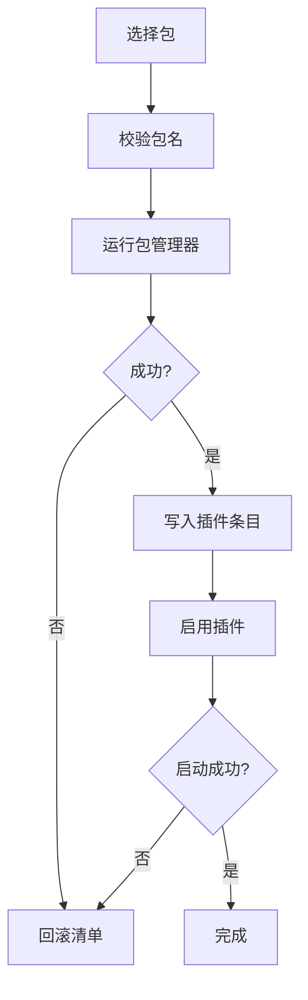

# 插件与市场

::: tip
ChatLuna 的绝大部分能力都来自插件：无论是聊天平台、模型提供商，还是工具、技能、记忆管理与对话轨迹，本质上都是插件。本节带你了解如何在控制台中安全地安装、启用与管理它们。
:::

ChatLuna 的丰富能力，几乎全是由各种插件组装起来的。

连接 QQ 或 Discord 需要平台适配器插件，接入各大模型需要模型提供商插件；想要赋予机器人搜索网页、运行代码或长期记忆等能力，也同样需要安装对应的扩展插件。

在 ChatLuna 内部，这些插件并不是扁平杂乱地堆在一起，而是像枝桠一样有序挂载在系统的「插件树」上。基础服务作为根基，业务插件各司其职，并通过层级分组来共享或隔离服务。因此，如何安全地安装、升级和卸载插件，直接决定了整个机器人实例能否长期稳定运行。

## 认识市场

市场是 ChatLuna 的官方扩展应用中心。

打开控制台，在左侧导航栏的「插件」分组中点击「市场」，即可进入市场页面。在这里，所有可用插件都会以卡片形式展示，供你随时搜索与浏览。

### 插件源

市场中的插件数据可以同时聚合自多个软件源。

每个源都有自己的优先级。当多个源包含同名插件时，系统会自动采用高优先级源的条目信息，但底层依然会记录提供过该插件的所有源。

### 索引缓存

市场的索引数据会持久化缓存在本地文件中。

系统默认每 10 分钟在后台自动刷新一次索引。即使服务器临时遇到网络故障，市场依然能借助本地缓存正常展示列表，只是暂时无法获取最新的插件动态。

### 兼容性检查

市场中的每一个插件条目，都会自动校验与当前 ChatLuna 版本的兼容性。

如果某个插件尚未适配当前运行时，卡片上会给出明确的兼容性提示。虽然不兼容的插件仍然允许展示，但为了系统稳定，建议不要尝试安装。

::: tip
遇到「市场里看得见，但就是装不上」的情况时，通常不是网络故障，而是该插件与当前核心版本不兼容，或是已被作者标记为废弃。
:::

## 安装插件

在控制台中安装插件非常简单，但它在背后绝非单纯「下载一个文件」，而是一次完整的事务操作。

前往「市场」页面，在搜索框中找到需要的插件，点击卡片右下角的「安装」按钮。系统随后就会启动完整的安装流程：

安装完成后，卡片上的按钮会切换为「已安装」。切换到左侧导航栏的「插件」页面，即可看到该插件已经添加并处于「已启用」状态；若该插件自带专属控制面板，导航栏中还会同步出现对应的新页面。

### 串行队列

所有的包管理操作都在同一个队列中串行执行。

无论是安装、升级还是卸载，系统在同一时刻只允许执行一个操作任务。这样可以避免多个操作同时改写配置文件，防止并发冲突。

### 事务回滚

插件安装具备完整的事务保障。

在开始安装前，系统会先在内存与磁盘中记录当前配置清单与依赖版本的完整快照。一旦中途遭遇下载中断、依赖报错或脚本异常，系统就会立刻恢复现场：抹去刚写入的条目并还原旧版本依赖，避免留下未完成的残留文件。

### 自动启用

依赖包下载成功后，文件就已经就位。

系统随后会将插件挂载到插件树的清单条目中，并调用初始化生命周期进行启用。如果在启用阶段由于缺少前置服务而启动失败，同样会自动触发事务回滚。

## 卸载插件

相比安装，卸载插件需要更加谨慎。

这是因为插件树中的其他插件可能正在依赖它提供的服务。贸然移除底层插件，可能导致依赖它的上层插件一同失效。

当你在「插件」页面点击某个插件卡片右上角的菜单并选择「卸载」时，系统会先在弹窗中列出受影响的下游插件列表，随后按以下流程退出：

1. 自动逐个停止所有依赖它的下游插件。
2. 等待这些插件完全释放占用的资源与服务。
3. 从磁盘环境中安全移除依赖包。
4. 从插件树清单中清理该插件配置条目。

如果卸载过程中的任何一步出现异常，系统同样会自动回滚到卸载前的初始状态。

::: warning
卸载提供核心底层服务的插件，可能会导致依赖它的一系列功能同时停摆。请在确认弹窗中的受影响列表为空，或清楚操作后果后再继续。
:::

## 热重载

在日常维护中，大部分插件都支持动态启用与停用，无需重启整个进程。

### 文件监听

系统内置了文件监控机制。

无论是在控制台页面中开关插件、修改表单配置，还是直接在外部修改清单文件，系统都能即刻察觉到变动，并自动重新加载对应的插件树节点。

### 热重载边界

支持热重载并不意味着所有改动都不需要重启。

不同的操作涉及不同的系统层级，热生效的边界也有所区别：

| 改动操作 | 能否热生效 | 说明 |
| --- | --- | --- |
| 新增插件 | 是 | 从市场安装或手动挂载新插件后，系统会自动加载并启动该节点 |
| 停用插件 | 是 | 只要没有运行中的下游插件依赖它，关闭开关即可立即卸载并释放资源 |
| 修改配置 | 视插件而定 | 取决于插件是否支持热更新；支持的即时刷新，不支持的需重启 |
| 修改分组与隔离 | 否 | 涉及插件树架构重构与服务可见域变更，必须重启进程才能生效 |

如果某次热重载由于内部错误而失败，该插件会自动保持在不可用状态，并在卡片和日志中记录具体的失败原因。

## 守护进程

实例内部运行着一个轻量的守护插件。

遇到需要重启或更新的场景时，该插件不会直接重启底层进程，而是将控制指令转交给外层的守护进程（supervisor）：

- **重启**：向外部守护进程发送请求，由它终止并重新拉起当前实例。
- **更新**：向外部守护进程发起申请，执行完整的核心升级与依赖重载流程。

将控制权交给外部守护进程，可以确保退出的中途状态保留、崩溃日志捕获以及重启后的健康检查都能由外层进程统一协调。

### 不受监管状态

并非所有启动方式都具备外部守护进程。

如果当前实例不是通过命令行常规启动（例如在容器或测试环境中直接运行单独的 worker 进程），守护插件会显示「不受监管」状态。此时系统无法通过界面一键重启，需要在宿主机或控制终端上手动重启进程。

## 安全模式

当某个实例因为插件报错而反复启动崩溃时，外部守护进程会自动触发并进入安全模式。

在安全模式下，系统不会加载任何业务插件，仅挂载最小运行环境：运行时健康检查与基本的平台适配器。

这样设计的目的，是确保即使插件树损坏，你依然能够打开控制台，在页面上排查、停用或卸载导致崩溃的问题插件。

::: tip
安全模式不是长期的降级运行方案，而是用于排障的紧急模式。在修复问题插件后，请及时重启恢复正常运行。
:::

## 创作模式

运行时提供了一种特殊的模式，允许 AI 模型根据对话指令直接修改系统配置。

开启创作模式后，模型可以在会话中通过专属工具调用系统能力：

- 实时查看当前运行时的健康状态与已加载条目
- 根据需求直接安装或启用指定的插件
- 动态调整提供商连接参数与角色预设

使用该模式的前提，是当前对话的用户与模型已被赋予相应的操作权限，所有行为依然会严格经过系统权限检查。

::: warning
开启创作模式意味着将控制台的一部分管理权限授予模型。请仅在充分信任当前模型与对话上下文的环境下开启，并在完成调整后及时退出。
:::

## 安全规范

扩展能力虽然方便，但安全规范同样不可忽视。

### 安装即执行

在 Node.js 生态中，安装 npm 依赖包意味着会在服务器上直接执行它的安装脚本和运行时代码。

这也是基于插件扩展的系统中最核心的潜在安全风险来源。

为了保证环境安全，建议遵循以下准则：

- 只从受信任的官方市场或经过验证的社区来源安装插件。
- 尽量将插件版本锁定在已知稳定的具体版本上，避免随意使用最新开发版。
- 在面向公网开放的实例中，务必在权限设置中关闭市场的公开操作入口。

### 控制台权限

控制台中的插件安装能力，在本质上等价于服务器的任意代码执行权。

因此 ChatLuna 默认仅允许本机访问控制台，并强制要求设置高强度的访问口令。请不要将未经身份验证的控制台直接暴露在公网中。

## 离线与内网镜像

在没有外网连接的局域网或内网私有环境中，插件机制同样可以正常运作：

- **市场浏览**：利用此前在联网环境下生成的本地缓存索引，依然能检索和查看插件列表。
- **包安装**：需要提前配置本地包管理器缓存，或在配置文件中指定可用的内网私有镜像源。

对于完全离线的内网私有化部署，建议在初始镜像构建时将常用插件预先打包，或在局域网内搭建私有 npm 代理源。

## 常见问题与排查

在日常使用插件和市场的过程中，如果遇到问题，可以参考以下思路排查：

**市场列表为空？**

首先检查服务器的网络连通性与软件源配置；其次检查本地缓存文件是否损坏；此外还需核对服务器系统时间是否准确，因为 TLS 证书校验对系统时间高度敏感。

**插件安装失败？**

查看弹出的安装控制台日志：排查指定的插件版本是否存在、本地网络能否正常连通镜像源、私有镜像源是否离线，或是安装构建脚本执行出错。

**安装成功后在控制台找不到对应页面？**

前往「插件」页面，检查该插件是否处于「已启用」状态；若已启用，再前往「日志」页面排查该插件在启动阶段是否因缺少前置依赖服务而挂起。

**卸载某个插件后，多个功能同时失效？**

这通常是因为卸载了提供基础核心服务的上游插件。可以在「插件」页面重新安装该插件，或从近期的系统配置快照中恢复。

**修改配置后界面未生效？**

检查当前改动的项目是否超出了热重载边界。涉及插件分组、隔离域或底层网络端口的变更无法热重载，在命令行或控制台中重启实例即可生效。

**实例启动反复崩溃并进入安全模式？**

说明插件树中有插件在启动时抛出了严重错误。可以在安全模式提供的管理界面中，前往「插件」页面逐个停用最近新增或更新的插件，即可排查定位问题。

## 下一步

- [认识 WebUI](./webui) — 市场与插件页的位置。
- [启动与插件树](/architecture/boot) — 插件树的内部结构。
- [多实例与多机器人](/manual/recipe/instances) — 实例级隔离。
- [排错与诊断](/cookbook/troubleshooting) — 起不来时怎么办。
